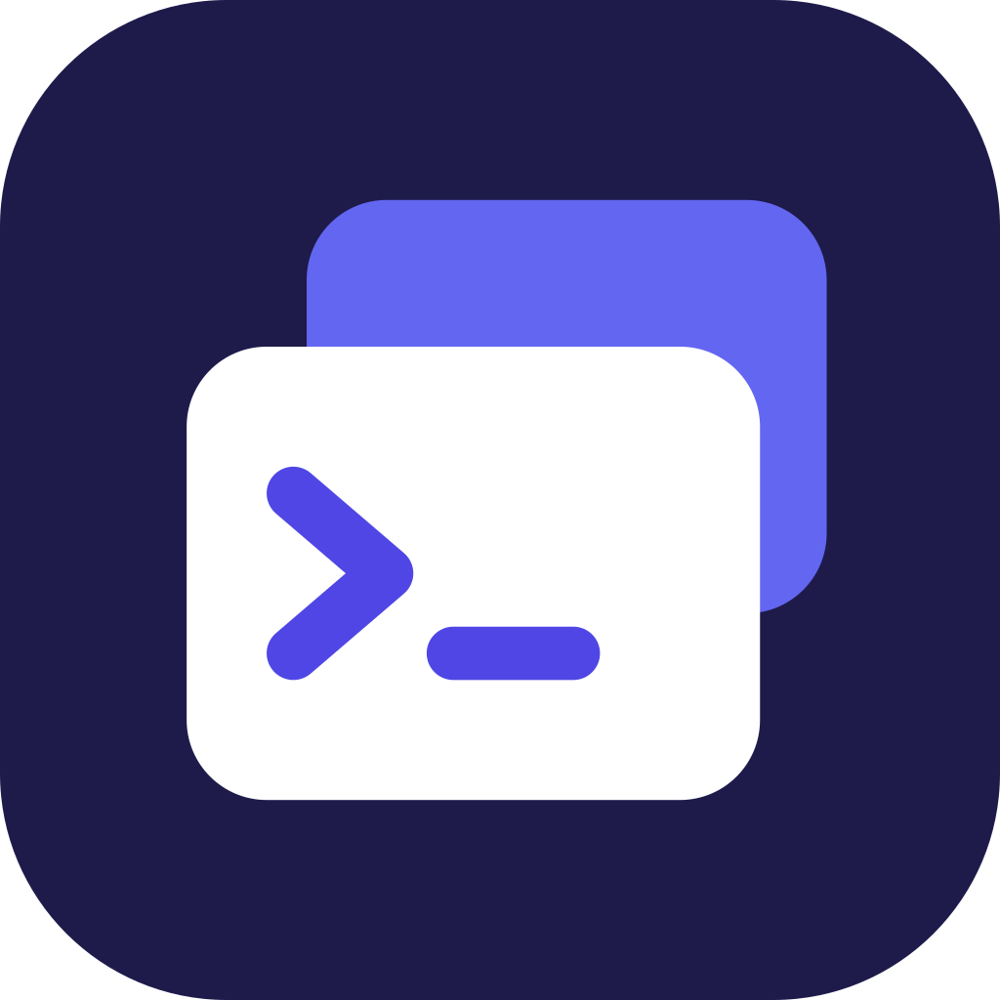

# Hostbay



Hostbay is an open-source desktop app for people who run servers: SSH
terminals, SFTP with an editor, RDP, Docker, systemd, IIS and more, in one
place, on Windows, macOS and Linux. It never connects to a host whose SSH key
or RDP certificate it has not verified, and it never keeps a saved secret on
disk in readable form.

Hostbay is a Go rewrite of SSH Manager on [Wails v3](https://v3.wails.io).
The plan is in
[docs/plans/2026-10-22-1100-feat-hostbay-go-desktop-port-plan.md](docs/plans/2026-10-22-1100-feat-hostbay-go-desktop-port-plan.md).
The previous Tauri app's source remains in git history before its removal.

## Develop

Requirements: Go 1.27, Node 20, and the Wails CLI pinned to the version in
`go.mod`:

```bash
go install github.com/wailsapp/wails/v3/cmd/wails3@v3.0.0-beta.27
```

```bash
npm install
wails3 dev        # run Hostbay with hot reload
go test ./...     # backend tests
```

On Linux, install `libgtk-3-dev` and `libwebkit2gtk-4.1-dev` first.

The React UI lives in `src/` and is shared with the old app during the port.
The Go backend lives in `internal/`.

## License

Apache License 2.0. See [LICENSE](LICENSE) and [NOTICE](NOTICE).
