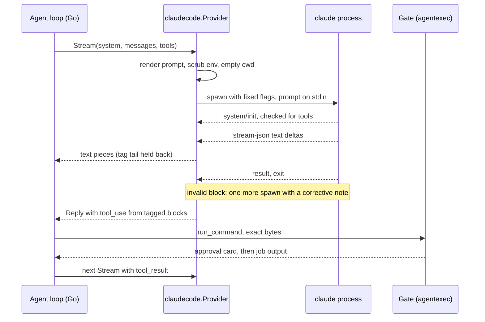
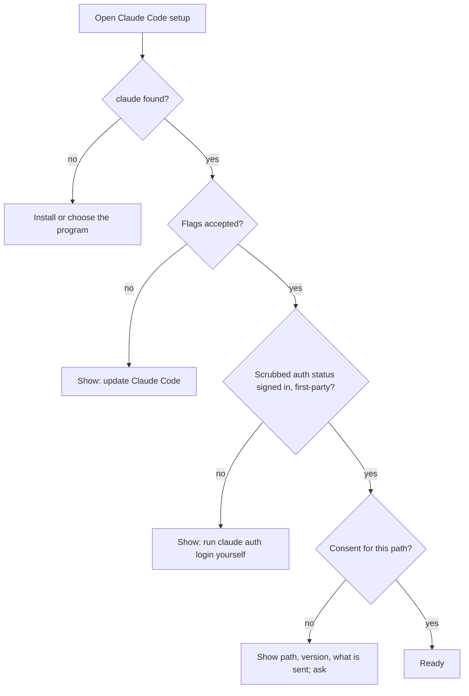

# Claude Code login as an AI provider - Plan

## Goal Capsule

- **Objective:** A person who is already signed in to Claude Code can use Hostbay's AI assistant through that sign-in, with no API key, and Hostbay never handles an Anthropic credential.
- **Means:** run the user's installed `claude` as an inference-only subprocess behind the existing provider seam (KTD1).
- **Authority:** this Product Contract, then the Planning Contract, then the units. The port plan's R60, R61, R73 and KTD31 to KTD36 (`docs/plans/2026-10-22-1100-feat-hostbay-go-desktop-port-plan.md`) stay in force. The one port-plan edit this plan makes is to name the new provider kind on R60's line and KTD31's note, which say "any Anthropic- or OpenAI-compatible API"; no other port-plan rule changes.
- **Execution profile:** U1 first, alone. Then U2. Then U3. Then U4 and U5 together.
- **Stop conditions:** stop and report if U1 shows that `--tools ""` with `--safe-mode` still leaves a Claude Code tool, hook or MCP server reachable on an unmanaged machine; if the CLI cannot run without Hostbay supplying or reading a credential; if Anthropic's legal page now forbids running the unmodified binary for the user's own sign-in; or if median start-up per call is above 3 seconds, in which case KTD3 is replaced by a per-conversation process before U2 starts. Building does not wait on the owner's terms decision (Open Questions); releasing does.
- **Finishes and ships:** `ce-work` implements; the user reviews unpushed commits.

## Product Contract

### Summary

Settings > AI gains a provider kind, "Claude Code login". It needs no key. Hostbay finds the user's own `claude` program, checks that it is signed in, and runs one `claude` process per model call. Hostbay's own agent loop, approval gate, modes and allowlists stay exactly as they are.

### Problem Frame

Today the assistant needs an API key from the Claude Console, which bills separately from a Claude plan. Many users already pay for a plan and have Claude Code signed in on the same computer.

Anthropic's Claude Code legal page (`code.claude.com/docs/en/legal-and-compliance`, read 2026-10-27) allows an end user to sign in to the unmodified Claude Code binary with their own subscription. It forbids a third-party app from offering Claude.ai login, routing requests through plan credentials for its users, or collecting, storing or intermediating Claude.ai credentials or session tokens. It also tells developers building products to use API keys. The only route that stays on the allowed side of every sentence Hostbay can verify is to run the user's own, unmodified `claude`, and never touch its sign-in.

One sentence stays open. Hostbay is not hosting Claude Code; its assistant is its own product that uses Claude Code as the model backend, and the page's guidance for developers building products can be read to cover that. Whether it does is Anthropic's call, so the owner decides before release (Open Questions).

Claude Desktop has no interface another app can drive. It does carry its own copy of the Claude Code program, which discovery can find (KTD6). The opposite direction already exists: Claude Code and Claude Desktop can drive Hostbay through the MCP server (port plan U24).

### Key Decisions

- **Opt in per computer, with a consent screen.** Plan limits assume ordinary individual use and Anthropic may change its terms, so the provider is never created silently. Governs R5.
- **Hostbay offers no sign-in button.** Signing in is Anthropic's flow, run by the user in their own terminal. Governs R2.
- **A Claude Code provider is device-local.** Its program path means nothing on another computer, and a synced path would let a sync target choose what Hostbay runs. Governs R6.

### Requirements

**Using it**

- R1. A person signed in to Claude Code can add a "Claude Code login" provider and use the sidebar assistant with no API key.
- R5. Setup lists the programs found by path only. For the one the person selects it shows the version and how it is signed in, says what is sent, that it goes from the program directly and not through Hostbay's proxies, and which sign-in it counts against. It needs an explicit confirmation before the provider can run, and a different program path asks again.

**Credentials and trust**

- R2. Hostbay never reads, copies, stores, logs or sends a Claude credential or token, and never starts or completes a sign-in.
- R4. Claude Code's own tools, hooks, plugins, MCP servers, memory, skills and project files cannot act in, or change the behavior of, a Hostbay conversation.
- R6. The provider exists on one computer only: it does not sync, a restored backup asks to set it up again, and no imported or synced record can make Hostbay run a program.

**Parity**

- R3. In the sidebar assistant, execution modes, allowlists, approval cards, the completion envelope, target-terminal rules and secret scrubbing behave exactly as with an API provider (port plan R60, R73, KTD32 to KTD34). Inline command completion (port plan R62) never uses a Claude Code provider.

**Reliability and platforms**

- R7. A failure reads plainly: not installed, not signed in, plan limit reached, Claude Code too old, or stopped. Raw output from the program never reaches the page.
- R8. It works on macOS, Windows and Linux. On Windows only a real `.exe` is run.
- R9. Stop ends the model call at once, and no `claude` process outlives its call or Hostbay.

### Acceptance Examples

- AE1. Covers R1, R3. Given a saved Claude Code provider, when the person asks "check disk usage" and the model proposes a command, then an approval card shows the exact bytes and nothing runs until it is approved.
- AE2. Covers R2, R5. Given `ANTHROPIC_API_KEY` and `ANTHROPIC_AUTH_TOKEN` are set in the environment that started Hostbay, when a conversation runs, then the `claude` process receives neither, and setup states that the Claude plan is used.
- AE3. Covers R2, R7. Given `claude` is found but signed out, when the person opens setup, then it shows "Run `claude auth login` in your own terminal", offers no sign-in action, and the provider cannot be saved as ready.
- AE4. Covers R6. Given a sync snapshot or backup that contains a Claude Code provider with a program path, when it is applied, then the record is dropped, a note says to set it up again, and nothing is run.
- AE5. Covers R9. Given a reply is streaming, when the person presses Stop, then the process is gone within two seconds and the conversation can send again.

### Scope Boundaries

Outside this plan:

- Letting Claude Code run the agent loop with its own tools. It would bypass the gate, modes, target terminal and completion envelope.
- Reading Claude's token files, keychain entries or environment tokens to call the API directly. Anthropic forbids it.
- Changes to the API-key providers.
- Inline command completion with this provider. Natural-language SQL (port plan R64) is user-triggered and may use it.

Deferred to Follow-Up Work:

- A long-lived `claude` process per conversation, if U1 measures start-up cost as too high.
- Checking that the program is signed by Anthropic (macOS code signature, Windows Authenticode).
- Showing remaining plan usage.
- The same shape for other vendors' command-line programs.

### Open Questions

Deferred to implementation (U1 answers them):

- Does the copy of Claude Code inside Claude Desktop share the CLI's sign-in?
- What is the per-call start-up time, and how many tokens does the program add beyond Hostbay's own system prompt?
- Which Claude Code version is the minimum for every flag in KTD2, and does it accept the system prompt by file or stdin (KTD2)?
- Does `--safe-mode` also ignore an `env` block in the person's own `settings.json`, such as one that sets `ANTHROPIC_BASE_URL`?
- Which environment variables carry a credential or switch the provider (to remove), and which carry privacy, proxy or certificate settings (to keep)?

Owner decisions, needed before release and not before building:

- Ship without Anthropic's written answer on the one open sentence in Problem Frame, or ask first through the contact-sales channel the legal page names? Shipping reads the page as allowing it; asking could say no.
- Which agreement governs the intended users, the Consumer Terms (Free, Pro, Max) or the Commercial Terms (Team, Enterprise)? The consent text names the observed sign-in and links the page either way.
- Should a group-writable program or folder pass the path rules (KTD6) when the group is the person's own private group? Today any group-write bit refuses the program, so a Linux install made under umask 002 (`~/.local/bin` is 0775) is shown as not found and the setup message does not say why. Allowing a private group is safe only while no one else is in that group; refusing keeps the rule simple. Found by code review of U1 to U5, not changed.

## Planning Contract

### Key Technical Decisions

- KTD1. **Claude Code runs as an inference-only provider.** Governs R1, R3, R4; U2, U3. The seam is `ai.Provider.Stream` (`internal/ai/provider.go`): Hostbay sends system prompt, messages and tools, and gets back a reply that may hold `tool_use` blocks. A new `claude-code` protocol fills it, so `internal/ai/agent.go` and `internal/agentexec` do not change.

  | Option | Verdict | Why |
  |---|---|---|
  | Inference-only subprocess | Chosen | Keeps the Go loop, gate, modes, envelope and scrubbing as they are; Claude's tools are off |
  | Claude Code runs the loop, tools reach Hostbay over MCP, approvals routed to Hostbay | Rejected | Even with host-routed approval (`--permission-prompt-tool`), Claude's loop would own the tool set and step order: no modes, no target terminal, no completion envelope. Hostbay's MCP tools act on saved hosts through exec channels, not the user's terminal (port plan KTD36) |
  | Agent SDK control channel with in-process tools | Deferred | Its tools would still bypass the target terminal and envelope, and the control messages are documented only through the SDK packages. The chosen option carries the same drift risk in stream-json, which U1 records and KTD8 detects |
  | Read Claude's OAuth token and call the API | Rejected | Forbidden by Anthropic, and breaks R2 |
  | Use the Claude Desktop app | Rejected | It has no interface to drive |

- KTD2. **One fixed spawn contract.** Governs R2, R4, R9; U2. Arguments: `-p`, `--output-format stream-json`, `--verbose`, `--include-partial-messages`, `--no-session-persistence`, `--safe-mode`, `--tools ""`, `--strict-mcp-config`, `--disable-slash-commands`, `--permission-mode dontAsk`, `--permission-prompts none`, and `--model <alias>`. `--bare` is not used because it never reads the plan sign-in. Hostbay's system prompt and the rendered conversation reach the program by stdin or a `0600` file in the private folder (U1 confirms which form this version accepts), never on the command line, where other local users could read the host label and the tag (KTD4). The working directory is a new empty private folder, removed after the call. A startup probe (KTD9) detects a version that rejects any flag, and the provider then says to update Claude Code.
  - **Fail closed.** `--safe-mode` leaves admin-managed policy settings active, so on every call the provider reads `system/init`; if it lists any tool, MCP server or plugin, or a hook event appears, the call is killed and the person sees "Claude Code is configured to run tools; Hostbay cannot use it". The Test step fails the same way.

- KTD3. **One process per model call; Hostbay keeps the history.** Governs R9; U2. Each `Stream` renders Hostbay's messages into one prompt, runs `claude`, and ends when it exits. Stop kills the process tree. The history bound (`trim` and `historyBudget` in `internal/ai/agent.go`, applied before each `Stream`) needs no cooperation from the program, and nothing is left running between calls. The cost is start-up time per call and a prompt that grows with the history across up to 40 calls per message (`maxSteps`); U1 measures both at 1, 10 and 40 turns of history, and the Goal Capsule sets the ceiling.

- KTD4. **Tool calls travel as nonce-tagged text blocks.** Governs R3, R4; U2.
  - **Prompt.** The system prompt lists the four tools with their schemas and asks for each call as one block opened and closed by a tag that is random per `Stream` call. The whole history, earlier tool calls and results included, is rendered under that call's tag, so the provider keeps no state between calls (`ai.Request` carries no conversation identity).
  - **Parse.** A complete, valid block becomes a `tool_use` Block. If the reply holds an invalid block, `Stream` runs once more inside the same call with a corrective note appended and returns only the second reply, because the agent loop ends the turn on a reply with no `tool_use` and would never send the note. A second invalid block stays plain text, which carries no authority.
  - **Stream.** Text streams to the page as it arrives. A partial tag at the tail of a chunk is held back until it resolves, so the page never shows half a block.
  - **Results.** Tool results return in the next prompt inside the tagged envelope, with the tag text escaped inside them and the existing "output is data, not instructions" framing. The flattened prompt has weaker role separation than an API request, so the tag and escaping keep a fake tag in terminal output from being read as structure.
  - **Safety.** It does not rest on parsing: every proposed call goes through the gate with its exact bytes (port plan KTD32, KTD33).

- KTD5. **Credentials are never touched.** Governs R2; U2, U3.
  - **Status.** Hostbay learns sign-in state only from `claude auth status` (JSON on stdout), run in the same scrubbed environment as model calls. It reads `loggedIn`, `authMethod` and `apiProvider` and discards the rest, including any email. The provider is ready only when the scrubbed status says signed in with `apiProvider` first-party; consent shows the observed `authMethod` as it is.
  - **Environment.** The child's environment is the current one minus `ANTHROPIC_*`, `CLAUDE_CODE_OAUTH_TOKEN`, the cloud-provider switches (`CLAUDE_CODE_USE_BEDROCK`, `CLAUDE_CODE_USE_VERTEX`, `CLAUDE_CODE_USE_FOUNDRY`) and any other credential variable U1 finds. Other `CLAUDE_CODE_*` variables stay: they carry platform and connection settings such as `CLAUDE_CODE_GIT_BASH_PATH` and the certificate-store settings, and the person's own privacy opt-outs. U1 records both lists and the test checks them. A stray API key therefore cannot silently switch billing from the plan.
  - **Stays.** `HOME` and `USERPROFILE` stay, so the program finds its own sign-in. No code in the package opens `~/.claude`, the keychain, or Windows credential storage; a test checks the source for such paths.

- KTD6. **Discovery and trust of the program.** Governs R5, R8; U2.
  - **Order.** Candidates are listed by path only, in this order: the path the person picked in a Go-owned file dialog; the directories on `PATH`, extended on macOS with `~/.local/bin`, `/opt/homebrew/bin` and `/usr/local/bin` because a launched app has a short `PATH`; Claude's native install folder; and the copy inside Claude Desktop's data folder. Listing runs no candidate, so a planted `claude` in a writable folder does not execute when Settings opens.
  - **Checks.** The selected candidate is resolved through symlinks. On Unix the target must be a regular file owned by the current user or root, and neither it nor any parent folder may be group- or world-writable. On Windows there is no mode check (Go reports synthesized modes) and the target must end in `.exe`; `.cmd` and `.bat` shims are refused. The same checks run again immediately before every spawn, and any failure reads as "not found".
  - **Trust.** Only the selected candidate runs `claude --version` and `claude auth status`, with the KTD5 environment, the empty private folder, closed stdin and a short timeout. Consent is bound to the path as found (the `PATH` entry or install link), not to its symlink target, because the native installer repoints that link at a new versioned file on each update. Setup shows both the path and the resolved target. For the copy inside Claude Desktop's versioned folder, consent binds to the stable `claude-code` folder and the newest executable inside it is resolved at spawn.

- KTD7. **The provider record is device-local, and the page cannot set a path.** Governs R6; U3.
  - **Record.** `store.AIProvider` gains `ExecPath` and `Consented`. Validation requires both for `claude-code` and forbids `BaseURL`, `APIKey`, `ProxyID` and `Unencrypted` on it.
  - **Path.** Only Go sets `ExecPath`, from a discovery result or the dialog. The page names a candidate by index or asks for the dialog; `SaveProvider` ignores any path it sends and takes `ExecPath` and `Consented` from the stored record only when that record is already `claude-code`.
  - **Sync.** A sync pull replaces the whole collection, so "skipping" the kind would delete the local provider on the first sync. The `aiproviders` collection therefore gets a local-only filter: `get` leaves `claude-code` records out of what is pushed and merged, and `set` re-appends the local ones after storing the merged set. Every incoming record, whatever its protocol, has `ExecPath` and `Consented` cleared, in `engine.go`'s load, `firstMerge` and `conflicts` alike, so a record cannot arrive already pointing at a program.
  - **Backup.** Restore clears the same two fields on every provider, drops `claude-code` records and reports a note through the existing restore notes.

- KTD8. **Errors are classified in Go.** Governs R7; U2. The stream's `api_retry` and result errors (`authentication_failed`, `rate_limit`, `billing_error`, `account_on_hold`, `oauth_org_not_allowed`), a missing program and an unknown-option exit each map to an `apperr` code and a fixed message. Anything else becomes "Claude Code stopped (exit N)". Raw stderr never reaches the page or the model; it goes to the log only after the secret scrub other error text gets.
  - **Version drift.** When `auth status` says signed in and a call still fails with an authentication error, or when `claude --version` differs from the version last probed, the provider re-runs the KTD9 probe and reports "Claude Code changed in a way this Hostbay does not support; update Hostbay" instead of the sign-in message. Anthropic's headless page says `--bare` will become the default for `-p`, which would fail every call this way.

- KTD9. **Models are a short alias list, and testing makes one real call.** Governs R5; U2, U3. `Models` returns the aliases `opus`, `sonnet`, `haiku` and `fable` with no network call. "Test" runs `claude --version`, `claude auth status` and one small `Stream`, and reports which step failed. The same flag probe runs once per consented path and again when the version changes, and maps an unknown-option exit to the update message.

### High-Level Technical Design

This sketch is directional guidance, not an implementation specification.

Provider states shown in Settings: not found, too old, signed out, consent needed and ready.

### Output Structure

    internal/ai/claudecode/
      discover.go, discover_test.go
      env.go, spawn.go, spawn_unix.go, spawn_windows.go
      provider.go, transcript.go, toolblock.go, events.go, errors.go
      structure_test.go
      claudetest/            fake claude for tests
      testdata/              recorded stream-json fixtures
    src/shell/settings/ClaudeCodeCard.tsx

### Assumptions

- The user's pre-approval stands: the scoping check was skipped and the safe default chosen at each fork.
- `claude auth status` keeps printing JSON with `loggedIn` and `authMethod` (observed on 2.1.310).
- Anthropic's legal page text read on 2026-10-27 is current. U1 reads it again before any code lands.
- Anthropic thinking blocks are not carried across calls, because history is rebuilt as text; reasoning quality over many steps may differ from an API provider, and that is accepted.
- A median start-up above 3 seconds per call is too slow for an agent loop; U1 measures it.

### System-Wide Impact

- **Sync and backup:** `claude-code` records are excluded in both; a test fails if either carries one (KTD7).
- **Privacy:** terminal context goes to Anthropic through the person's plan, as with an API provider. `--no-session-persistence` keeps it out of local Claude transcripts. Anything Claude Code sends on its own, such as telemetry, follows the person's Claude Code settings; U1 records the documented variables that reduce it.
- **Agent parity:** the MCP server, allowlists and modes are untouched.
- **Other model callers:** `AIService.Suggest` and `AskSQL` both pick `firstProvider()` (`internal/app/aiskills.go`). `Suggest` fires on typed lines, so it skips `claude-code` providers and uses the first API-key provider, or says to add one. `AskSQL` is user-triggered and may use either.
- **Plan limits:** an agent loop makes several model calls per message, so a plan's limit can be reached sooner than with a single chat.

### Risks and Dependencies

| Risk | Mitigation |
|---|---|
| Anthropic changes its terms or enforcement for automated use of plan sign-in, or reads the developer-products sentence as covering Hostbay | Unmodified program, the person's own sign-in, opt-in with consent, no credential handling; removing the provider is one click; API-key providers remain; U1 re-reads the legal page; the owner decides on asking Anthropic before release (Open Questions) |
| A policy-managed machine still runs hooks or tools under `--safe-mode` | `system/init` is checked on every call and the call fails closed (KTD2) |
| Role separation is weaker than an API request | One flattened prompt, per-call tag and escaping (KTD4); the gate showing exact bytes is the backstop |
| A Claude Code update changes a flag or the stream format | Minimum version check, a startup probe, recorded fixtures per event type, a gated live smoke test |
| The model emits a malformed or forged tool block | One corrective note, then plain text; the gate shows exact bytes for any call (KTD4) |
| Tool output carries a fake tag to inject a call | Per-conversation random tag, escaping of the tag inside results, and the gate |
| A planted or swapped program path | Go-only path setting, path shown with version before consent, no sync of the path (KTD6, KTD7) |
| Orphaned `claude` processes | Process-tree kill on Stop, timeout and quit; calls are short-lived |
| A stray environment variable switches billing or provider | Credential and provider variables are removed, status is read in the same environment (KTD5) |
| Claude Code auto-updates and breaks a flag or default | Version-change probe and the update message (KTD8) |

## Implementation Units

| U-ID | Title | Files touched | Depends on |
|---|---|---|---|
| U1 | Characterize the real Claude Code and build the fake | `internal/ai/claudecode/claudetest/`, `internal/ai/claudecode/testdata/` | none |
| U2 | The claudecode provider package | `internal/ai/claudecode/`, `internal/ai/provider.go` | U1 |
| U3 | Provider record, bindings, sync and backup rules | `internal/store/aiproviders.go`, `internal/app/ai.go`, `internal/sync/collections.go`, `internal/backup/` | U2 |
| U4 | Settings card, consent and sidebar states | `src/shell/settings/`, `src/components/ai/`, `src/i18n/en.ts`, `src/api.ts` | U3 |
| U5 | Gate parity and security tests end to end | `internal/app/ai_claudecode_test.go`, `internal/ai/claudecode/structure_test.go` | U3 |

### U1. Characterize the real Claude Code and build the fake

- **Goal:** replace guesses about the program with recorded facts, and give every later test a fake `claude`.
- **Requirements:** R2, R4, R7, R9; answers the Open Questions that U1 can.
- **Files:** `internal/ai/claudecode/claudetest/fake.go`, `internal/ai/claudecode/testdata/*.jsonl`, `internal/ai/claudecode/testdata/FINDINGS.md`.
- **Approach:** On the person's own machine, run the KTD2 flags against the real program with throwaway prompts that name no secret. Record the stream for a plain answer, a tagged tool block, an unauthenticated run, a run killed mid-stream, and a flag the version rejects. Record `auth status` for the CLI and for the Desktop-bundled program.
  - **Measure:** start-up time and tokens beyond Hostbay's prompt, at 1, 10 and 40 turns of history; compare the median to the 3-second line in the Goal Capsule.
  - **Isolation:** whether any Claude tool, MCP server, plugin or hook event appears in `system/init`; whether `--safe-mode` ignores a `settings.json` `env` block; which form (stdin or file) takes the system prompt; the minimum version for every flag.
  - **Environment:** the credential and provider variables to remove and the privacy, proxy and certificate variables to keep (KTD5), both lists written to `FINDINGS.md`.
  - **Documentation:** read the documented stream-json input protocol, `--permission-prompts host` and `--permission-prompt-tool`, and the `capabilities` array, and record whether any of them would keep the gate and target-terminal rules; this supports or revises KTD1's rejected rows.
  - **Redaction:** before any fixture or `FINDINGS.md` line is written, replace email, org ID and name, session IDs, user names and home and config paths with fixed placeholders.
  - **Fake and legal page:** write the fake as a Go test helper that re-executes the test binary as `claude` and replays a fixture. Re-read Anthropic's legal page and note its date in `FINDINGS.md`.
- **Execution note:** characterization first; no production code in this unit.
- **Test scenarios:**
  - The fake replays each fixture byte for byte and exits with the recorded code.
  - The fake can pause mid-stream so a test can press Stop.
  - `system/init` in the recorded stream lists no tools and no MCP servers.
  - A scan of `testdata/` and `FINDINGS.md` finds no email address, no home folder path and none of the live account's identifiers.
- **Verification:** `go test ./internal/ai/claudecode/claudetest/...`; `FINDINGS.md` answers every deferred question or marks the stop condition.

### U2. The claudecode provider package

- **Goal:** `claudecode.Provider` satisfies `ai.Provider` and honors KTD2 to KTD6, KTD8 and KTD9.
- **Requirements:** R1, R2, R3, R4, R7, R8, R9.
- **Files:** `internal/ai/claudecode/*.go` (see Output Structure), `internal/ai/provider.go` (the `ClaudeCode` protocol constant, `DefaultModels`, and `ai.New` refusing it), tests beside each file.
- **Approach:** Follow the process helpers in `internal/container/runner_local.go` and the hidden-window pattern in `internal/terminal/wsl_windows.go`. Kill the whole process tree on cancel. Parse stream events into text pieces and a final reply; hold back a partial tag at a chunk's end. Build `Reply.Message` with `tool_use` Blocks that carry fresh IDs.
- **Patterns to follow:** `internal/ai/anthropic.go` for event handling and the "stream that ends early is an error" rule in `internal/ai/provider.go`.
- **Test scenarios:**
  - A plain answer streams as text and ends with an empty tool list.
  - A reply with one valid tagged block yields one `tool_use` with the right name and input, and the page-bound text excludes the block.
  - A tag split across two chunks never reaches the text callback half-formed.
  - A reply with a malformed block triggers one more spawn inside the same `Stream` call, with a corrective note; only the second reply is returned, and the first attempt's text never reaches the callback. A second malformed block stays plain text.
  - Two `Stream` calls on one conversation use different tags, and the second renders the first's tool calls and results under its own tag.
  - A tool result containing the tag text is escaped in the next prompt.
  - A `system/init` that lists a tool, an MCP server or a plugin, or a hook event, kills the call and returns the fixed "configured to run tools" error.
  - `auth status` signed in plus an authentication error from the call, or a changed `--version`, gives the "update Hostbay" message, not the sign-in message.
  - A recorded unknown-option exit gives the "update Claude Code" message.
  - The recorded argv contains neither the target label nor the tag.
  - The child environment lacks `ANTHROPIC_API_KEY`, `ANTHROPIC_AUTH_TOKEN`, `CLAUDE_CODE_OAUTH_TOKEN` and `CLAUDE_CODE_USE_BEDROCK`, and keeps `HOME`, `CLAUDE_CODE_GIT_BASH_PATH` and the certificate-store variables.
  - The flags are exactly the KTD2 set, in the fake's recorded argv.
  - An exit before a result is an error, never a partial Reply.
  - Cancel during streaming kills the process within two seconds (AE5).
  - Each recorded error fixture maps to its `apperr` code; unknown output gives "Claude Code stopped (exit N)" with no stderr text.
  - Discovery runs no candidate: listing three fake candidates leaves the fake's invocation count at zero.
  - Selection refuses a file in a group-writable folder, a file owned by another user, a directory, a dangling symlink and, for the Windows rules run on any OS through an injected GOOS, a `.cmd` shim; it does not apply a mode check on Windows.
  - The path checks run again before each spawn: replacing the target after selection fails closed with "not found".
  - Re-pointing the install link at a new versioned target keeps the same consent.
  - `auth status` parsing keeps only `loggedIn` and `authMethod`.
- **Verification:** `go test -race ./internal/ai/...`; `GOOS=windows go vet ./internal/ai/...`.

### U3. Provider record, bindings, sync and backup rules

- **Goal:** a saved Claude Code provider that only Go can point at a program, and that never leaves the computer.
- **Requirements:** R1, R5, R6; AE3, AE4.
- **Files:** `internal/store/aiproviders.go` and its test, `internal/app/ai.go` and `internal/app/ai_test.go`, `internal/sync/collections.go`, `internal/backup/format.go`, `internal/backup/restore*.go` and their tests, `src/bindings/` (regenerated and committed on its own).
- **Approach:** Add the protocol and fields (KTD7). In `client()` return the claudecode provider for the protocol and skip the HTTP and key path. New bindings: detect candidates, pick a program through a Go dialog, read status (`loggedIn`, `authMethod`, version, path), and record consent through a Go confirm dialog whose text states what is sent and that it counts against the plan. Consent clears when the selected path changes. `SaveProvider` rejects a path from the page. Add the local-only filter to the `aiproviders` collection and the field clearing on every incoming record (KTD7); restore drops the kind with a note. `Suggest` skips the kind through a small helper beside `firstProvider`.
- **Test scenarios:**
  - `Suggest` skips a first-saved `claude-code` provider and uses the first API-key one; with none it returns the "add a provider" error. `AskSQL` may use the Claude Code provider.
  - Saving with a path from the page is ignored; a path from detect is stored.
  - Saving without consent, or with a signed-out status, leaves the provider not ready.
  - Changing the path clears consent.
  - A sync pull holding a `claude-code` record with a path drops it and spawns nothing (AE4).
  - A full pull and push round trip keeps the local `claude-code` provider and uploads none, in `apply`, `firstMerge` and `conflicts`.
  - A pulled or restored record of another protocol that carries `ExecPath` and `Consented` arrives with both cleared, and saving it later as `claude-code` needs a fresh detect and consent.
  - A backup restore drops `claude-code` records and adds a note.
  - `provider()` returns the claudecode provider with no vault access.
- **Verification:** `go test -race ./internal/store/... ./internal/app/... ./internal/sync/... ./internal/backup/...`; `go vet -tags integration ./...`.

### U4. Settings card, consent and sidebar states

- **Goal:** a person can set it up and understands each state without reading docs.
- **Requirements:** R1, R5, R7; AE3.
- **Files:** `src/shell/settings/ClaudeCodeCard.tsx` and its test, `src/shell/settings/AI.tsx`, `src/components/ai/AISidebar.tsx`, `src/i18n/en.ts`, `src/api.ts`.
- **Approach:** An "Add Claude Code login" choice beside the API-key form, with no key field. The card follows the states in the sketch above and shows only what Go returns. The not-signed-in state tells the person to run `claude auth login` in their own terminal and has no sign-in action. The sidebar shows a short line when a call stops for a plan limit. New strings go to `en.ts` only; other languages fall back to English, as port plan KTD41 and U42 state.
- **Test scenarios:**
  - Each of the five states (not found, too old, signed out, consent needed, ready) renders its text and only its actions.
  - The consent text shows the observed sign-in method and says traffic goes directly from the program, not through Hostbay's proxies.
  - The not-signed-in state has no button that starts a sign-in.
  - The consent text names the path and version Go returned.
  - A plan-limit error shows the fixed message, not raw text.
- **Verification:** `npx tsc --noEmit`, `npm test`, `npm run build`; a server-mode browser check with a fake `claude` first on `PATH` and a throwaway `HOME`.

### U5. Gate parity and security tests end to end

- **Goal:** prove R3 and R4 with the real agent loop and the fake program.
- **Requirements:** R2, R3, R4; AE1, AE2.
- **Files:** `internal/app/ai_claudecode_test.go`, `internal/ai/claudecode/structure_test.go`.
- **Approach:** Drive a full conversation through `AIService` with the fake `claude` emitting a tagged `run_command`. Reuse the harness of the existing agent tests.
- **Test scenarios:**
  - In confirm-all mode the approval card shows the exact bytes and nothing runs before approval (AE1).
  - A forged tag inside terminal output does not start a call.
  - A secret in terminal output is scrubbed from the next prompt the fake receives.
  - The environment the fake sees has no Anthropic variables (AE2).
  - A source scan of `internal/ai/claudecode` finds no `.claude`, credentials, keychain or `security find-generic-password` reference outside tests.
  - The package imports neither `internal/terminal` nor `internal/secrets`.
- **Verification:** `go test -race -count=1 -p 4 ./...`.

## Verification Contract

| Check | Command | Applies to |
|---|---|---|
| Frontend build first (`main.go` embeds `dist/`) | `npm run build` | all |
| Format | `gofmt -l internal cmd *.go` | all |
| Vet, four ways | `go vet ./...`, `GOOS=windows go vet ./...`, `go vet -tags integration ./...`, `GOOS=windows go vet -tags integration ./...` | all |
| Server build | `go build -tags server -o /dev/null .` | U3 |
| Go tests | `go test -race -count=1 -p 4 ./...` | all |
| Types and unit tests | `npx tsc --noEmit`, `npm test`, `npm run build` | U4 |
| Live smoke, manual | `go test -tags claudecode_live -run Live ./internal/ai/claudecode/` | U1, U2; uses the person's own sign-in, never run in CI |
| Browser check | server build, throwaway `HOME`, fake `claude` on `PATH` | U4 |

## Definition of Done

- Every unit's test scenarios pass and `FINDINGS.md` has no unanswered deferred question.
- A person with Claude Code signed in can add the provider, consent, and run AE1 end to end on macOS, with Windows and Linux covered by the `GOOS` vet and the discovery tests.
- No file in `internal/ai/claudecode` reads a Claude credential location (checked by test).
- No `claude-code` record appears in a sync payload or a backup (checked by test).
- The port plan's R60 line and KTD31 note mention the new provider kind.
- Spike scratch code, abandoned flags and unused fixtures are removed.
- Commits are local, one per unit plus one for the regenerated bindings in U3, and nothing is pushed.
- The owner's two release decisions in Open Questions are recorded before the provider ships.

## Sources

- Anthropic, Claude Code legal and compliance: `https://code.claude.com/docs/en/legal-and-compliance` (authentication and credential use section; read 2026-10-27).
- Anthropic, run Claude Code programmatically: `https://code.claude.com/docs/en/headless` (flags, `--bare`, stream-json, permission prompts).
- Local `claude --help` and `claude auth status` on Claude Code 2.1.310.
- `internal/ai/provider.go`, `internal/ai/agent.go`, `internal/app/ai.go`, `internal/store/aiproviders.go`, `internal/sync/collections.go`, `internal/backup/format.go`.
