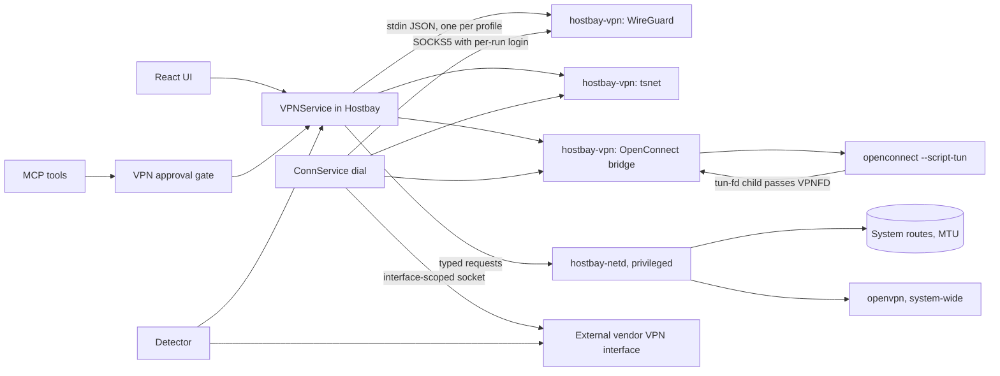
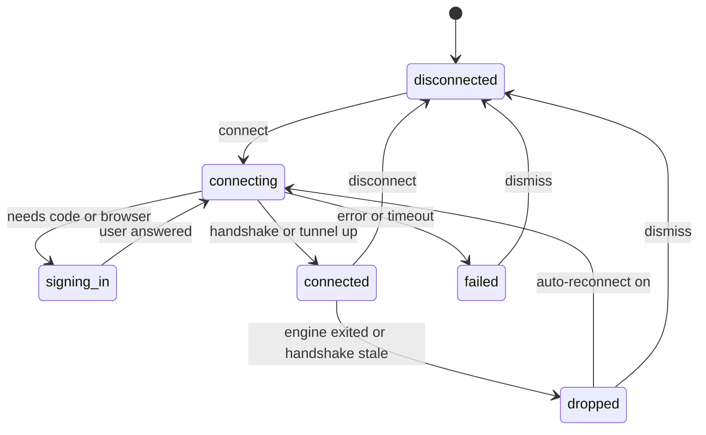
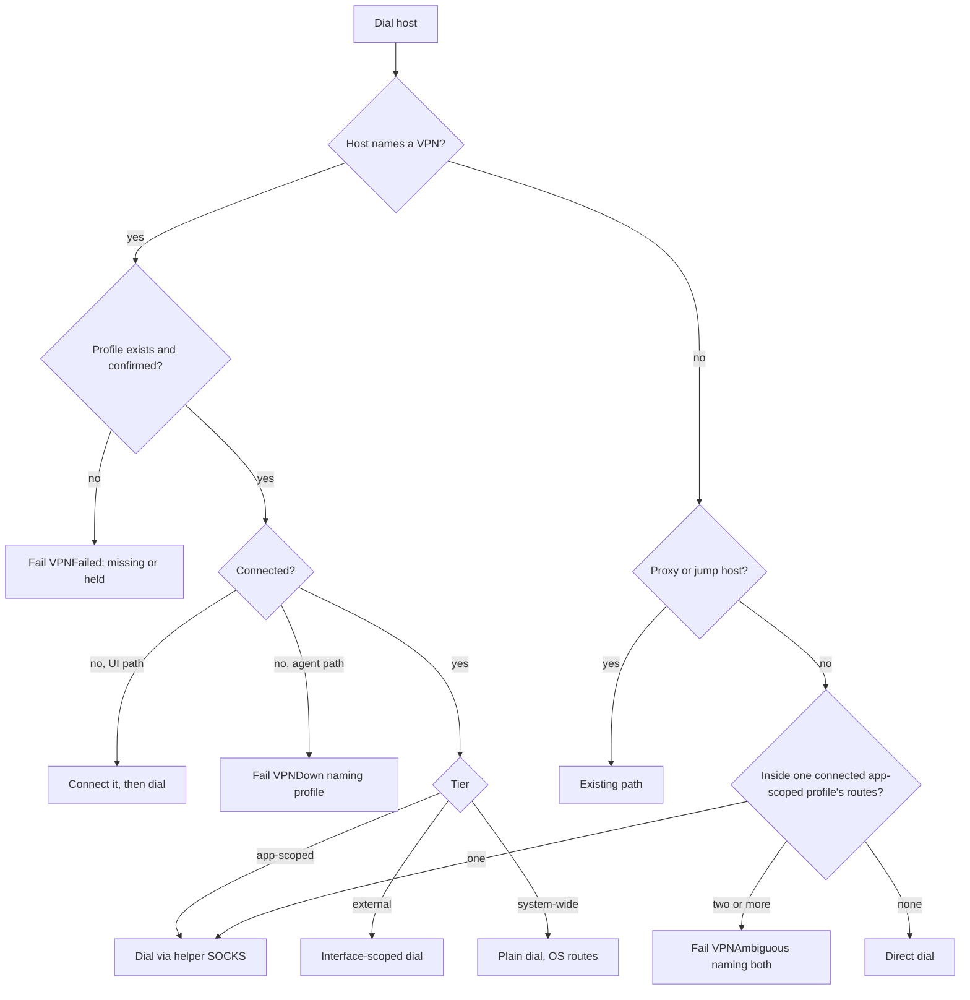
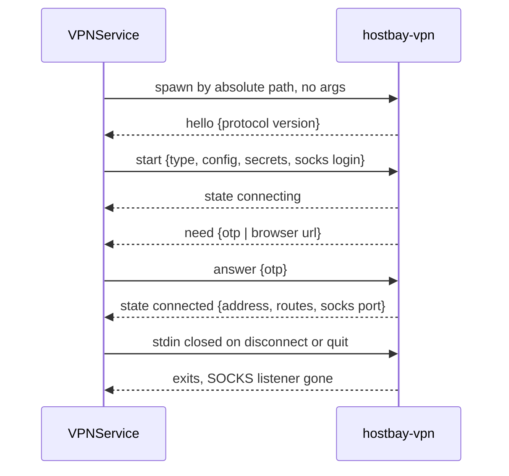

# VPN Profiles - Plan

## Goal Capsule

- **Objective:** A Hostbay user reaches hosts that sit behind one or more VPNs without leaving Hostbay: they import or create a VPN profile once, tag it with project names, and Hostbay (or an MCP agent, after approval) brings up the right VPN when a host or tag needs it, with several VPNs up at the same time and each destination routed through the right one.
- **Means:** VPN engines run in a separate unprivileged helper process per connected profile, and Hostbay dials through each one as if it were a proxy (KTD1, KTD2). Route changes run through a narrow privileged helper (KTD8).
- **Product authority:** the user pre-approved this plan's decisions and asked that safe defaults be chosen instead of questions (memory: autonomous Hostbay execution). Defaults chosen here are listed under Assumptions so a reviewer can overturn them. The user's TunnelHub app is the source of ideas, not code to port. The Product Contract outranks the Planning Contract; a KTD outranks a unit's Approach.
- **Open blockers:** none. The privileged helper (R30) gates only the system-wide and external-routing phase.
- **Execution profile:** Deep, four phases (KTD13). Each unit lands as its own commit on `main`; nothing is pushed.
- **Stop conditions:** stop and record evidence, then continue with the next unit, when a platform cannot run a protocol app-scoped (it drops to system-wide per R2), or when a vendor VPN defeats interface-scoped dialing (KTD7 falls back to routes). Stop the whole run only if a change would weaken host-key, certificate or secret handling.
- **Who finishes:** `ce-work` implements unit by unit; the user installs the build and then retires TunnelHub through R45.

---

## Product Contract

Product Contract preservation: changed: R45 added, because the user will remove TunnelHub once this ships; ZeroTier moved from app-scoped to external, because its embeddable library needs a native C build per platform; OpenConnect rows now state the Windows system-wide split that research confirmed. Document review (user pre-approved defaults): R17 now excludes hosts with a proxy or jump host and defines matching; R20 limits browser sign-in to protocols that offer it, and an SSL VPN that needs SAML stays external through its vendor app; R31 states the interim caller check until releases are signed and the route bounds the helper enforces; R34 keys allow entries to a token and a profile and never skips the card for a system-wide profile.

### Summary

Hostbay gains VPN profiles: saved, synced, tagged definitions of a VPN that Hostbay connects itself or drives through the vendor's client.
Most protocols run inside Hostbay as app-scoped tunnels that carry only Hostbay's own traffic, so several VPNs, even with overlapping networks, stay up together without admin rights.
For VPNs that must own the system routing table, Hostbay brings TunnelHub's routing into the app: it detects every connected VPN, labels its tunnel interface, and routes each destination through its chosen VPN or the local network.

### Problem Frame

The hosts Hostbay manages for a project often sit behind that project's VPN, and different projects use different VPN products.
Today the user starts each VPN in its own vendor app, remembers which VPN a host needs, and fights the vendor clients for the routing table, because most of them install a full-tunnel route that swallows the other VPN's networks.
The user built TunnelHub to fix the routing half of this on macOS: it runs on top of already-connected VPN clients and rewrites routes per destination.
TunnelHub still leaves connecting to each vendor app, knows nothing about hosts, needs a hand-edited config, and runs only on macOS.
An MCP agent asked to run a command on a project's host has no way to bring the VPN up, so the request fails with a timeout that does not say why.

### What TunnelHub does, and what Hostbay takes from it

TunnelHub (`~/Documents/Santhosh/tunnel-hub`, Tauri 2, macOS only) never connects a VPN. It waits for vendor clients to connect, then edits the routing table.

| TunnelHub behavior | How it works there | In Hostbay |
|---|---|---|
| Detect VPNs | `scutil --nc list` for system VPNs, a running-process scan for daemon VPNs such as AnyConnect's `vpnagentd`, and leftover point-to-point `utun` interfaces for agent VPNs such as Harmony SASE. | Kept: external VPN detection (R22, R23). |
| Label tunnels | Maps each `utun` to a VPN by `scutil` interface name, then peer CIDR, then tunnel shape (point-to-point vs peer-less). Two VPNs of the same shape stay unlabeled rather than guessed. | Kept, including "never guess" (R24). |
| Routing modes | Full (install `0.0.0.0/1` and `128.0.0.0/1` on one VPN), Split (only listed networks through the VPN), Dual (each destination to its own VPN or `local`), Reset. | Kept for system-wide and external VPNs (R25, R26). |
| Coexistence fixes | Strips a VPN's half-internet routes in Dual mode and narrows a greedy route such as `10.0.0.0/8` to the subnets it needs, so a second VPN can connect. Sets tunnel MTU to 1280 to stop SSH stalls. | Kept (R27, R28). |
| Auto-apply | Re-runs the chosen mode when a VPN tunnel appears, and tells the user. | Kept, and re-applies when an agent re-pushes routes (R29). |
| Privileged helper | A root LaunchDaemon on a Unix socket runs only `route` and `ifconfig`, so the user approves once at install. | Kept as an idea, made safe (R30, R31). |
| Chrome profile routing | Launches a Chrome profile with `--proxy-server=socks5://…` bound to a VPN's SOCKS endpoint. | Kept, and Hostbay supplies the SOCKS endpoint itself for app-scoped VPNs (R32, R33). |
| Menu-bar control | Tray menu switches modes; window closes to the tray. | Kept as tray actions for profiles (R10). |

Two TunnelHub weaknesses Hostbay must not copy: its helper socket is world-writable (`0666`), so any local program can rewrite the routing table as root, and its route changes are best-effort with failures ignored, so the user cannot tell a partial apply from a full one.

### Where VPNs plug into Hostbay

Hostbay already sends most connections through one dial step, which makes an app-scoped VPN one more way to dial, beside direct, proxy and jump host.

- SSH first hops go through `sshx.DialTCP` (`internal/sshx/dial.go:43`). Telnet, raw TCP, VNC, SPICE, Kubernetes and database hosts go through `ConnService.dialHost` (`internal/app/conn.go:541`). A missing proxy is an error, never a direct dial (KTD22 of the port plan).
- Three paths do not use that step and need their own VPN wiring: RDP hands the helper the host's address when there is no jump host or proxy (`internal/app/rdp.go:72`); file hosts (FTP, S3, WebDAV, SMB) dial directly when no proxy is set (`internal/app/transfer.go:108`); mosh opens its own UDP socket (`internal/terminal/mosh.go:157`).
- Hostbay's SOCKS5 server for dynamic SSH tunnels (`internal/tunnel/socks.go`) is the piece R32 reuses to expose an app-scoped VPN to a browser profile.

### Supported VPN types

Labels are the UI names. The Fortinet-compatible type never shows a vendor name in the UI.

| UI name | Protocol | Tier (R2) | Notes |
|---|---|---|---|
| WireGuard | WireGuard | App-scoped | Runs inside Hostbay in userspace; no admin. System-wide on request. |
| Tailscale / Headscale | WireGuard mesh | App-scoped | Joins the tailnet inside Hostbay as its own node. |
| Cisco AnyConnect / Secure Client | AnyConnect | App-scoped | Through OpenConnect in its no-admin mode on macOS and Linux; system-wide on Windows, where that mode does not exist. |
| SSL VPN (PPP over TLS) | Fortinet-compatible | App-scoped | Through OpenConnect for password, certificate and one-time code. A gateway that requires browser sign-in (SAML) stays external, connected in the vendor app. |
| Palo Alto GlobalProtect | GlobalProtect | App-scoped | Through OpenConnect, same platform split as AnyConnect. |
| Pulse / Ivanti Connect Secure | Pulse, Network Connect | App-scoped | Through OpenConnect, same platform split. |
| F5 BIG-IP SSL VPN | F5 | App-scoped | Through OpenConnect, same platform split. |
| Array Networks SSL VPN | Array | App-scoped | Through OpenConnect, same platform split. |
| ZeroTier | ZeroTier | External | Detected and routed; joined with `zerotier-cli` where installed. |
| OpenVPN | OpenVPN 2.x | System-wide | Needs a tunnel device, so admin rights through the helper. Linux can use OpenVPN 3 without admin. |
| IKEv2 / L2TP over IPsec | IPsec | System-wide | Through the operating system's own VPN service. |
| Perimeter 81 / Harmony SASE | Vendor | External | Detected and routed; connected in the vendor app. An admin-issued `.ovpn` can be imported as an OpenVPN profile instead. |
| Any other connected VPN | Vendor | External | Cisco Secure Client app, the SSL VPN vendor app, OpenVPN Connect, Tunnelblick, Cloudflare WARP, NetBird, Zscaler: detected and routed; launched or driven through their CLI where one exists. |

### Key Decisions

- **App-scoped first.** A VPN inside Hostbay carries only Hostbay's traffic, needs no admin rights, cannot break other networking, and lets VPNs with overlapping networks coexist. This is what makes "several VPNs at once" dependable. Governs R2, R12, R14.
- **TunnelHub's routing covers what app-scoped cannot.** VPNs that must own the system routing table, and vendor clients Hostbay cannot replace, are routed per destination the way TunnelHub does it, inside Hostbay and on every platform. Governs R22 to R29.
- **A VPN is a dial path, like a proxy.** A host names the VPN it is reached through, and nothing falls back to a direct dial when that VPN is down. Governs R15, R16.
- **The helper is narrow and authenticated.** One approval installs it; it accepts requests only from Hostbay and only route, interface and VPN-start operations Hostbay names. Governs R30, R31.
- **Tags are shared with hosts.** A project tag means the same thing on a host and on a VPN profile, so one tag finds a project's hosts and the VPN that reaches them. Governs R6, R7.
- **An agent never connects a VPN silently.** Bringing a VPN up changes what the computer can reach, so an MCP connect asks in the approval tray unless the user allowed that profile for that token. Governs R34.

### Requirements

**Profiles and tags**

- R1. A VPN profile stores a name, a type from the supported table, the gateway, the sign-in method, any certificates or keys, its route list, its DNS settings, and its tags.
- R2. Each profile runs in one tier: app-scoped (inside Hostbay, Hostbay traffic only), system-wide (the whole computer, through the helper), or external (a vendor client Hostbay detects and routes). A type that supports app-scoped defaults to it.
- R3. An external profile names the installed client; Hostbay launches it, connects and disconnects through its CLI where one exists, and otherwise shows the client's own state.
- R4. Profile secrets (passwords, private keys, pre-shared keys) are sealed like proxy passwords and bound to the profile's type, gateway and user, so editing the gateway makes the old secret unopenable.
- R5. Profiles sync across the user's computers like proxies do, including the hold that waits for this computer to confirm a synced change.
- R6. A profile carries any number of tags; tags are free text, matched without regard to case, and shared with host tags. The host editor gains the same tag editor.
- R7. The VPN list filters by tag and by text, and each tag shows how many hosts and VPN profiles carry it.

**Connecting, several at once**

- R8. The user connects and disconnects a profile from the VPN list, from a host's menu, from the command palette, and from the tray.
- R9. Each profile shows live state: connecting, signing in, connected (with assigned address, routes, interface and uptime), failed with a reason, disconnected, or dropped with a reason.
- R10. The tray lists profiles with their state and connects or disconnects one without opening the window.
- R11. Hostbay lists connected profiles in one place with which hosts and browser profiles are using each.
- R12. Any number of app-scoped profiles may be connected at the same time, including profiles whose route lists overlap.
- R13. A system-wide profile may connect while other system-wide or external VPNs are up only when the routing plan of R25 can place it; otherwise Hostbay names the conflicting profile and does not connect.
- R14. App-scoped profiles never change the system routing table, DNS or interfaces.
- R15. A host may name one VPN profile it is reached through. Connecting to that host brings the profile up first when it is down, then dials through it, for every host kind including RDP, file hosts and mosh.
- R16. A host whose VPN profile cannot connect or was deleted fails with that reason; it never dials directly instead.
- R17. A host with no named profile, no proxy and no jump host, whose address falls inside exactly one connected app-scoped profile's routes, dials through that profile. An IP address matches the profile's route networks, excluding default and half-internet routes (`0.0.0.0/0`, `::/0`, `0.0.0.0/1`, `128.0.0.0/1`); a hostname matches only the profile's DNS domains and is never resolved through the system resolver to decide. When two connected profiles both match, the host does not connect and Hostbay asks the user to name one on the host.
- R18. A dropped VPN is shown as dropped and is reconnected only if the profile's auto-reconnect setting is on; sessions that used it end with the reason.
- R19. Quitting Hostbay with VPNs connected asks first, as it does for running tunnels, and disconnects the profiles Hostbay connected.

**Sign-in**

- R20. Profiles support each sign-in their protocol offers: username and password, client certificate, one-time code, and, for protocols whose engine supports it, browser sign-in (SAML) in the user's default browser. A type that cannot do browser sign-in does not offer it.
- R21. A gateway certificate the system does not trust is shown with its fingerprint and pinned only after the user accepts it; a changed certificate refuses the connection, as Hostbay does for RDP and TLS hosts.

**Routing system-wide and external VPNs (from TunnelHub)**

- R22. Hostbay detects VPNs already connected on this computer, whether registered with the operating system, run by a vendor daemon, or present only as a tunnel interface, and offers each as an external profile.
- R23. A detection refresh adds newly installed VPNs and drops removed ones, keeping any profile that hosts or routes still use.
- R24. Hostbay labels each tunnel interface with its VPN by the operating system's own name for it, then by the profile's address range, then by tunnel shape; when two VPNs cannot be told apart it leaves both unlabeled and asks the user to pin one, and never routes traffic on a guess.
- R25. A profile's routes apply in one of four modes: full tunnel, split tunnel, per-destination (each network to its own VPN or to the local network), and reset (remove every route Hostbay added).
- R26. Before applying, Hostbay shows the planned route changes and reports afterwards which changes succeeded and which failed.
- R27. In per-destination mode Hostbay removes half-internet routes that a VPN's full-tunnel setting installed, and offers to narrow a greedy route such as `10.0.0.0/8` to the subnets that VPN needs so another VPN can connect.
- R28. Each profile sets its tunnel MTU, defaulting to 1280.
- R29. When a VPN connects, or a vendor agent re-pushes its routes, Hostbay re-applies the chosen mode automatically if the profile's auto-apply setting is on, and notifies the user.
- R30. System-wide routing and system-wide profiles use a privileged helper installed once after the user agrees in a native dialog that says what it can do; without it, they show why they cannot run.
- R31. The helper accepts requests only from the Hostbay app of the user who installed it (checked by user and executable path until releases are code-signed, then by signature), only for route, interface MTU and VPN start and stop operations, and only within bounds it can enforce itself: routes added only through a tunnel interface or the default gateway, routes deleted only when it journaled them or they sit on a tunnel interface.

**Browser and app routing (from TunnelHub)**

- R32. An app-scoped profile can expose a local SOCKS5 endpoint on `127.0.0.1` that carries traffic through that VPN.
- R33. *(Superseded by `docs/plans/2026-11-03-1127-feat-vpn-domain-routing-plan.md`: browsers now reach a VPN through the system PAC, and the launcher and its mappings are removed.)* The user maps a Chrome or Chromium-family browser profile to a VPN profile and launches it from Hostbay pointed at that VPN's SOCKS endpoint; a profile with no SOCKS endpoint says so instead of launching unrouted.

**MCP agent**

- R34. MCP gains tools to list VPN profiles (filtered by tag), report their state, connect one by profile or by tag, and disconnect one the agent connected. Connect and disconnect go through the approval tray unless the user allowed that profile for that token; a system-wide profile always asks.
- R35. Connecting by tag picks the single profile carrying that tag; when several carry it, the tool returns the candidates instead of choosing.
- R36. `list_connections` reports each host's tags and the VPN profile it is reached through.
- R37. Running a command on a host whose VPN is down returns an error that names the VPN profile, instead of a timeout.

**Import and routing**

- R38. Import reads VPN configuration files: OpenVPN `.ovpn` (with inline certificates), WireGuard `.conf`, Cisco AnyConnect profile `.xml`, Apple `.mobileconfig`, NetworkManager `.nmconnection`, Windows phonebook `.pbk`, Tunnelblick `.tblk` folders, and Viscosity `.visc` bundles.
- R39. Import also scans known locations of installed clients on this computer (Tunnelblick, Viscosity, OpenVPN, AnyConnect profiles, NetworkManager, Windows phonebooks) and lists what it finds for the user to pick.
- R40. Import keeps the file's routes and DNS settings: OpenVPN `route` lines and `redirect-gateway`, WireGuard `AllowedIPs` and `DNS`, AnyConnect split-include and split-exclude lists, NetworkManager route and DNS entries.
- R41. Import also reads a TunnelHub `vpn-config.json`, turning its VPNs into external profiles, its `routes` into per-destination routes and its `chrome` entries into browser mappings.
- R42. Every imported profile shows its route list in an editor before saving, where the user can switch between full and split tunnel and add or remove networks and DNS domains.
- R43. Import never runs or keeps scripts from a config file (`up`, `down`, `script-security` and similar); it lists each ignored directive in the import report.
- R44. Import never stores a secret that was not in the file or that the user did not type; a profile imported without its password asks for it on first connect.

**Retiring TunnelHub**

- R45. When Hostbay finds TunnelHub's privileged helper, launch-at-login agent or config on this computer, it offers to import the config (R41) and then remove the helper and agent after the user agrees in a native dialog, and reports what it removed.

### Key Flows

- F1. Connect a host behind a VPN
  - **Trigger:** the user opens a host that names VPN profile P.
  - **Steps:** Hostbay sees P is down, connects P (asking for a one-time code or opening browser sign-in if needed), then dials the host through P. The tab shows "via P".
  - **Outcome:** the session runs; P stays up until the user disconnects it or quits.
  - **Covered by:** R8, R9, R15, R16, R20
- F2. Several projects at once, app-scoped
  - **Trigger:** the user works on projects A and B, whose VPNs both route `10.0.0.0/8`.
  - **Steps:** the user connects both app-scoped profiles. Host A1 names profile A and host B1 names profile B; both connect.
  - **Outcome:** each host's traffic goes through its own VPN; nothing else on the computer changes.
  - **Covered by:** R12, R14, R15, R17
- F3. Two vendor VPNs, per-destination
  - **Trigger:** Harmony SASE and the SSL VPN vendor client are both connected, and Harmony pushed `10.0.0.0/8`.
  - **Steps:** Hostbay detects and labels both tunnels, shows the plan (strip Harmony's halves, narrow `10.0.0.0/8` to its subnets, route `10.212.0.0/16` to the SSL VPN), the user applies, and Hostbay reports each change.
  - **Outcome:** both VPNs carry their own networks; the plan re-applies if Harmony re-pushes its routes.
  - **Covered by:** R22, R24, R25, R26, R27, R29
- F4. Agent reaches a project host
  - **Trigger:** an MCP agent is asked to check disk space on hosts tagged `atlas`.
  - **Steps:** the agent calls `list_connections`, picks hosts tagged `atlas`, sees they are reached through "Atlas VPN", connects by tag `atlas`, the user approves in the tray, then the agent runs its command.
  - **Outcome:** the command runs; the approval card named the profile and the token.
  - **Covered by:** R34, R35, R36
- F5. Import with routing
  - **Trigger:** the user drops an `.ovpn` file onto the VPN list.
  - **Steps:** Hostbay parses it, shows the gateway, sign-in method, routes and DNS, lists ignored script directives, and asks for tags.
  - **Outcome:** a saved profile with its split-tunnel routes and no secret the file lacked.
  - **Covered by:** R38, R40, R42, R43, R44

### Acceptance Examples

- AE1. **Covers R16.** **Given** host H names profile P and P's gateway is unreachable, **when** the user opens H, **then** the tab fails with "VPN P could not connect: <reason>" and nothing is sent to H's address outside P.
- AE2. **Covers R17.** **Given** app-scoped profiles A and B are connected and both route `10.1.0.0/16`, **when** the user opens host `10.1.2.3` that names no profile, **then** the connect fails and asks the user to choose A or B on the host.
- AE3. **Covers R13, R14.** **Given** an app-scoped WireGuard profile is connected, **when** the user connects a system-wide OpenVPN profile with `redirect-gateway`, **then** it connects, because the app-scoped profile uses no system routes. **Given** instead a second system-wide full-tunnel profile is connected, **then** the new one does not connect and names the other.
- AE4. **Covers R24.** **Given** two point-to-point VPNs are connected and neither has an address range or interface pin, **when** Hostbay refreshes, **then** both stay unlabeled, per-destination mode refuses routes for them, and the user is asked to pin one.
- AE5. **Covers R26, R31.** **Given** the helper is installed, **when** a non-Hostbay program sends it a route request, **then** the helper refuses it; **when** Hostbay applies a plan and one route fails, **then** the report names the failed route and the profile shows "partly applied".
- AE6. **Covers R33.** **Given** browser profile "Work" maps to an external profile with no SOCKS endpoint, **when** the user launches it, **then** Hostbay does not launch it and says the VPN has no SOCKS endpoint.
- AE7. **Covers R35.** **Given** two profiles tagged `atlas`, **when** an agent connects by tag `atlas`, **then** nothing connects and the tool returns both profile names.
- AE8. **Covers R21.** **Given** a pinned gateway certificate, **when** the gateway presents a different certificate, **then** the connection is refused and the user sees both fingerprints.
- AE9. **Covers R43.** **Given** an `.ovpn` with `up /tmp/x.sh` and `script-security 2`, **when** it is imported, **then** the profile saves without them and the report lists both lines as ignored.

### Scope Boundaries

- **Deferred for later:** a kill switch; VPN traffic graphs and history; routing programs other than Hostbay and Chromium-family browsers; IPv6 per-destination routes.
- **Outside this product's identity:** acting as a VPN server or gateway; replacing vendor clients whose sign-in works only in the vendor's app; running VPN config scripts.

#### Deferred to Follow-Up Work

- XPC code-signing and Authenticode caller checks for `hostbay-netd` once releases are signed (KTD8).

#### Considered and not built

- Per-launch credentials on the browser SOCKS listener: Chromium cannot send them; the loopback-only listener matches today's dynamic SSH tunnels. Revisit if a supported browser gains SOCKS login.
- An MCP audit log beyond the approval tray: no existing contract requires one; revisit if agents gain unattended VPN access.

### Dependencies / Assumptions

- Fact: OpenConnect's no-admin mode (`--script-tun`) works on macOS and Linux and is not supported on Windows (`tun-win32.c`), so OpenConnect protocols run system-wide on Windows.
- Assumption: OpenConnect's Fortinet-compatible protocol has no browser sign-in, so an SSL VPN that requires SAML stays external, connected in the vendor app.
- Assumption: Hostbay has no browser sign-in flow today (the Claude Code provider asks the user to run `claude auth login`), so SAML sign-in is new work.
- Assumption: Harmony SASE offers no third-party protocol access except an admin-issued `.ovpn`, so it stays external unless that file is imported.
- Assumption: Hostbay's existing host `tags` field, which the UI does not yet edit, is the shared tag store.

### Outstanding Questions

**Deferred to Implementation**

- The exact file locations R39 scans on each platform (U13 confirms each against a real install).
- Whether interface-scoped dialing reaches hosts through each vendor VPN on each platform (U10 prototypes it against Harmony SASE and the SSL VPN client before relying on it).
- Which Headscale versions the pinned Tailscale library supports (U7 records the tested pair).

### Sources / Research

- TunnelHub, `~/Documents/Santhosh/tunnel-hub` (machine-local): `README.md`, `CLAUDE.md`, `src-tauri/src/routing.rs` (detection, labeling, modes, greedy-route narrowing), `src-tauri/src/helper.rs` (root helper), `src-tauri/src/lib.rs` (tray, auto-apply, helper install).
- `internal/sshx/dial.go`, `internal/sshx/proxy.go`, `internal/app/conn.go`: the shared dial step and the no-direct-fallback rule.
- `internal/app/rdp.go`, `internal/app/transfer.go`, `internal/terminal/mosh.go`: the dial paths that bypass it.
- `internal/store/proxies.go`, `internal/sync/holds.go`: the sealed, synced, held pattern R4 and R5 follow.
- `internal/mcp/tools.go`, `internal/agentexec/gate.go`: MCP tools and the approval gate R34 extends.
- `internal/tunnel/socks.go`: the SOCKS5 server R32 reuses.
- OpenConnect non-root mode: https://www.infradead.org/openconnect/nonroot.html; protocol changelog: https://www.infradead.org/openconnect/changelog.html
- WireGuard userspace netstack: https://git.zx2c4.com/wireguard-go/tree/tun/netstack
- Harmony SASE OpenVPN tunnel: https://support.perimeter81.com/docs/openvpn-tunnel.md
- `docs/plans/2026-10-22-1100-feat-hostbay-go-desktop-port-plan.md`: KTD5 (leases), KTD18 (certificate pinning), KTD22 (no direct fallback), R33 (loopback by default).
- Planning research (machine-local, best effort): repo patterns, agent parity and engine best practices dossiers under `/tmp/compound-engineering-501/ce-plan-research/ceee4185/`. The plan below governs any disagreement.
- OpenConnect Windows script-tun status: https://gitlab.com/openconnect/openconnect/-/raw/master/tun-win32.c
- tsnet: https://pkg.go.dev/tailscale.com/tsnet
- Route APIs: https://pkg.go.dev/golang.org/x/net/route, https://pkg.go.dev/github.com/vishvananda/netlink, `golang.zx2c4.com/wireguard/windows/tunnel/winipcfg`

---

## Planning Contract

### Key Technical Decisions

- KTD1. **One unprivileged `hostbay-vpn` helper process per connected app-scoped profile.** The main binary is already 31.35 MiB against the 36 MiB CI gate (KTD30 of the port plan); wireguard-go with gVisor adds about 8 MB and tsnet about 20 MB. A separate executable keeps the gate, isolates gVisor crashes from open sessions, and makes "several VPNs at once" several processes. It follows the RDP helper's rules: found only beside `os.Executable()`, newline-delimited JSON over stdin and stdout with a version handshake, secrets only on stdin, exits when stdin closes (`internal/rdp/supervisor.go`). Governs R12, R14.
- KTD2. **Hostbay dials an app-scoped VPN through an authenticated loopback SOCKS5 endpoint the helper serves.** Hostbay generates a random user and password per run and sends them on stdin; the VPN-backed `sshx.Proxy` carries only the profile ID and looks up the live SOCKS port and login at each dial, so a shared connection outliving a reconnect never dials a stale port. SSH first hops, `dialHost` and `testTCP` gain VPN reach with no per-kind code; RDP, file hosts and mosh, which bypass that step today, are wired in U4. The helper also serves SOCKS5 UDP ASSOCIATE, bound to the client's source port, so mosh can use it. Failures carry a new `apperr.VPNFailed` code, never `ProxyFailed`, and never fall back to a direct dial (KTD22 of the port plan). Governs R15, R16, R37.
- KTD3. **Engines inside `hostbay-vpn`.** WireGuard uses the root `golang.zx2c4.com/wireguard` module's `tun/netstack` (never the stale nested module) with keepalive 25 s and status from `IpcGet` handshake times. Tailscale uses `tailscale.com/tsnet` with an in-memory `StateStore` whose node keys Hostbay seals and keeps device-only (never synced), a per-profile directory (mode 0700) for anything else, and `logtail.Disable()` so nothing is sent to Tailscale's log service. For OpenConnect protocols the `hostbay-vpn` parent spawns the `openconnect` binary with `--script-tun` pointing at `hostbay-vpn tun-fd`; that short-lived child passes the `VPNFD` datagram socket back to the parent over an inherited Unix socket (`SCM_RIGHTS`), and the parent bridges it into a gVisor stack and serves the same SOCKS endpoint. `hostbay-vpn` refuses an `openconnect` older than the minimum version the protocols need, with a reason. Passwords go through `--passwd-on-stdin` with `--non-inter`; gateway pins use `--servercert pin-sha256:`. Upgrade Tailscale and WireGuard together, never gVisor alone. Governs R2, R20, R21.
- KTD4. **`store.VPN` is a new synced collection with one sealed field.** Sync carries one sealed field per collection (`internal/sync/collections.go`), so every profile secret (password, private key, pre-shared key, auth key) is sealed together as one JSON object. `SecretAAD` binds ID, type, gateway, user and tier. `Host.VPNID *string` mirrors `ProxyID` with held and missing stand-ins. `SchemaVersion` goes 3 to 4, `bundleVersion` 4 to 5, and the sync snapshot's `ReaderVersion` and `minReaderVersion` (`internal/sync/snapshot.go`) 5 to 6, so older builds refuse the data, locally, in backups and over sync, instead of dropping it. Device-only values (helper installed, executable paths, browser mappings, auto-connect state) live in `store.Local`. Governs R1, R4, R5, R6.
- KTD5. **Dial resolution order.** A host's own VPN wins; a host with a VPN and a proxy is refused at save and connect, as jump-plus-proxy is today; a VPN plus a jump host is allowed and carries the first hop. In a jump chain the outermost hop's VPN carries the chain; a later hop naming a different VPN is refused at save and connect. Route matching (R17) applies only to hosts with no VPN, proxy or jump host, matches IP literals against route networks other than default and half-internet routes, and matches hostnames only against the profile's DNS domains, never by asking the system resolver. A host bound to a system-wide profile checks that the OS route for its address resolves to that profile's interface before dialing, and fails with `VPNFailed` otherwise. The connection key gains `~vpn:<id>@<revision>` so editing a profile opens a fresh shared connection. Governs R15, R16, R17.
- KTD6. **Agents never trigger auto-connect.** The agent dial path (`promptlessLease`, `internal/app/conn.go`) returns `VPNDown` or `VPNAmbiguous` naming the profile instead of connecting; the agent then calls `connect_vpn`. MCP VPN tools use the shared `Approvals` tray through a small VPN gate, not `HostJobs`. Allow entries live in a new `MCPSettings.VPNAllow` list keyed by token and profile and bound to the profile's type, gateway and tier, added only in Settings; they skip the card for app-scoped and external profiles and never for a system-wide one. Governs R34, R35, R36, R37.
- KTD7. **External VPNs: interface-scoped dialing first, routes second.** A host bound to an external profile dials with the socket pinned to that VPN's interface (`IP_BOUND_IF` on macOS, `SO_BINDTODEVICE` on Linux 5.7+, `IP_UNICAST_IF` on Windows), which needs no admin rights and leaves the system routing table alone. Where a vendor VPN defeats that, or for traffic from other programs, Hostbay uses the routing engine (U11) through the privileged helper. Detection and labeling port TunnelHub's algorithm, including "never guess". Governs R3, R22, R23, R24.
- KTD8. **`hostbay-netd` is a small, typed privileged helper.** It exposes only: add or delete a route to a CIDR via an interface or the local gateway, set a tunnel interface's MTU, start or stop OpenVPN with a helper-owned config (scripts disabled), start or stop OpenConnect on a Wintun adapter on Windows, start or stop a system-wide WireGuard tunnel, and stream route-change events. It validates every argument, runs no shell, and launches only `openvpn` and `openconnect` copies it placed in a root-owned directory at install, checking owner and mode before each start. It writes OpenVPN configs itself from allowlisted typed fields (refusing `plugin`, `log`, `writepid`, `script-security`, `up`, `down` and every other file- or script-bearing directive) and runs the management interface on a Unix socket in its root-owned directory with `management-client-user` set to the installing user (a random password file on Windows). Route bounds are enforced in the helper: add only via a tunnel interface or the default gateway; delete only journaled routes or routes on a tunnel interface. It journals every route before adding it and every vendor route before deleting it, and its sweep, on client disconnect or restart, removes Hostbay's routes and restores the deleted vendor routes. Requests and replies carry a protocol version; a mismatch makes Hostbay offer to reinstall the helper, and a changed Hostbay path offers to re-pair. Caller check: macOS and Linux use a socket owned by the installing user (mode 0600) plus a peer UID check and an executable-path check; Windows uses a named pipe whose DACL grants only the installing user plus an image-path check. Releases are not code-signed today, so XPC code-signing requirements and Authenticode checks replace the path check once signing exists. Install is one native admin prompt per platform (launchd daemon, systemd unit, Windows service); on Linux the helper ships only in the deb and rpm packages, and an AppImage build shows that system-wide routing cannot run. Governs R13, R30, R31.
- KTD9. **Routing engine is a pure planner plus an executor.** A planner turns profiles, labeled interfaces and the live route table into a list of route changes, which the UI shows before apply and the executor sends to `hostbay-netd`; the executor reports each change's result. Greedy-route stripping, narrowing and re-apply on route events reuse the same planner. When a full-tunnel or per-destination plan would capture a connected app-scoped profile's gateway endpoint, the planner pins a host route to that endpoint via the local gateway so app-scoped tunnels keep working. Re-apply is debounced and rate-capped so Hostbay does not fight a vendor agent, and also runs at Hostbay startup and whenever the helper connection is re-established. Hostbay's routes live only while Hostbay runs; the helper sweep removes them when it quits. Governs R25, R26, R27, R28, R29.
- KTD10. **Tray and window close.** Hostbay gains a system tray (Wails v3 `SystemTray`) listing profiles. A local setting "Keep running in the menu bar when the window closes", off by default, hides the window instead of quitting; with it off, quitting with VPNs up asks first (R19). Governs R10, R19.
- KTD11. *(Superseded in part by `docs/plans/2026-11-03-1127-feat-vpn-domain-routing-plan.md`: the no-login listener stays and the system PAC points browsers at it; the launcher and mappings are removed.)* **Browser routing uses a separate no-login loopback SOCKS listener.** Chromium cannot sign in to a SOCKS proxy, so a browser mapping opens a second listener on `127.0.0.1` without credentials for the life of that VPN connection, the same model as today's dynamic SSH tunnels. MCP never reports its port. Mappings are device-local. Launch refuses when that browser profile is already running (live Chrome `SingletonLock`), since Chrome would reuse the running unproxied process, and passes `--force-webrtc-ip-handling-policy=disable_non_proxied_udp` so WebRTC cannot leak around the proxy. Governs R32, R33.
- KTD12. **Import produces `Bundle.VPNs`.** VPN parsers return an `importer.Result` whose bundle carries VPN profiles, so import and backup share one restore path (`backup.Restore`) and the import report gains a VPN count and the ignored-directive list. One package per source: `internal/importer/vpnconf` for config files and `internal/importer/tunnelhub` for TunnelHub. Governs R38 to R44.
- KTD13. **Four phases, TunnelHub parity on macOS before the long tail.** Phase A delivers profiles, WireGuard and host binding; Phase B the other app-scoped engines and packaging; Phase C the privileged helper, external detection and routing (TunnelHub parity, macOS first, then Linux and Windows); Phase D import, MCP, browser, tray and TunnelHub retirement. U14 (MCP) and U15 (browser) need only Phase A, so they run right after U5; U-IDs stay as numbered. Execution order: U1 to U5, U14, U15, U6 to U13, U16, U17.

### High-Level Technical Design

Component topology:

Profile states:

External profiles never enter `connecting` from Hostbay unless a vendor CLI exists; they move between `disconnected` and `connected` as detection sees their interface.

Dial resolution for a host (KTD5):

Helper start handshake (directional):

### Assumptions

- Interface-scoped dialing works through Harmony SASE and the SSL VPN vendor client on macOS; U10 proves it before relying on it, and KTD7's route fallback covers a failure.
- A per-user socket owned by the installing user plus a path check is an acceptable helper caller check until releases are signed (KTD8).
- Linux uses the distribution's `openconnect` package; macOS bundles OpenConnect and its libraries; Windows bundles it only for the system-wide path.
- Browser mappings and the "keep running in the menu bar" setting are per device and do not sync.
- Re-apply on vendor route re-push is capped at once per 5 seconds per profile.
- TunnelHub's `kind`, `peer`, `iface`, `display`, `exclude` and `mtu` fields map one to one onto external profile fields; its `match` regex is kept only as a detection hint.

### Implementation Constraints

- Every new UI string goes in `src/i18n/en.ts`; the Fortinet-compatible type is labeled "SSL VPN (PPP over TLS)" everywhere a user can see it.
- Generated bindings in `src/bindings` are regenerated and committed with the service changes that cause them.
- No secret appears in argv, logs, events or MCP output; the SOCKS login and browser port never leave Hostbay and the helper.
- The main `hostbay` binary must stay within the CI size budget; VPN libraries are imported only by `cmd/hostbay-vpn` and `cmd/hostbay-netd`.

### System-Wide Impact

- **Data:** schema 4 and bundle 5 are one-way for older builds, which refuse the new data with their existing message.
- **Security boundary:** `hostbay-netd` is the first root or SYSTEM component Hostbay ships; its request schema is the attack surface and gets its own tests.
- **Agent parity:** MCP gains four tools and `list_connections` changes shape (adds fields only).
- **Packaging:** two new executables per platform, plus OpenConnect libraries on macOS and Windows, and new LGPL notices in `NOTICE`.

### Risks & Dependencies

| Risk | Mitigation |
|---|---|
| gVisor version skew breaks the netstack build | Pin Tailscale and WireGuard together; CI builds `cmd/hostbay-vpn` on all three platforms with a netstack smoke test |
| Vendor agent keeps re-pushing routes | KTD9 debounce and cap; report "fighting" in the profile state |
| OpenConnect on macOS needs relocatable libraries | U8 bundles with rewritten install names; protocols fall back to external if the bundle fails to load |
| Unsigned helper caller check is weaker than code signing | KTD8 path and UID checks now; record the upgrade to signing checks as follow-up work |
| Headscale rejects a newer tsnet | U7 records the tested Headscale version and pins Tailscale |

---

## Implementation Units

| U-ID | Title | Key files | Depends on |
|---|---|---|---|
| U1 | VPN profile store, sync and backup | `internal/store/vpns.go`, `internal/sync/collections.go`, `internal/backup/format.go` | none |
| U2 | `hostbay-vpn` helper with WireGuard and SOCKS | `cmd/hostbay-vpn/`, `internal/vpn/` | none |
| U3 | VPNService: supervise, state, events | `internal/app/vpns.go`, `internal/vpn/supervisor.go`, `main.go` | U1, U2 |
| U4 | Dial integration and host binding | `internal/sshx/proxy.go`, `internal/app/conn.go`, `internal/app/rdp.go`, `internal/app/transfer.go`, `internal/terminal/mosh.go` | U3 |
| U5 | VPN panel, profile editor, host VPN and tags | `src/components/VpnPanel.tsx`, `src/shell/settings/Vpns.tsx`, `src/shell/HostEditor.tsx` | U3, U4 |
| U6 | OpenConnect protocols app-scoped | `internal/vpn/openconnect/`, `internal/vpn/tunfd/` | U2, U3 |
| U7 | Tailscale and Headscale | `internal/vpn/tailnet/` | U2, U3 |
| U8 | Packaging and CI for `hostbay-vpn` and OpenConnect | `Taskfile.yml`, `build/*/Taskfile.yml`, `.github/workflows/ci.yml`, `NOTICE` | U2, U6 |
| U9 | `hostbay-netd` privileged helper and its packaging | `cmd/hostbay-netd/`, `internal/netd/`, `internal/app/netd.go` | U2 |
| U10 | External VPN detection and scoped dial | `internal/vpn/detect/`, `internal/sshx/bind_*.go` | U3, U4 |
| U11 | Routing engine and modes | `internal/vpn/routing/`, `internal/app/routing.go` | U9, U10 |
| U12 | System-wide profiles | `internal/vpn/openvpn/`, `internal/vpn/osvpn/` | U9, U11 |
| U13 | VPN import | `internal/importer/vpnconf/`, `internal/importer/tunnelhub/` | U1, U5 |
| U14 | MCP VPN tools | `internal/mcp/vpn.go`, `internal/agentexec/approvals.go` | U3, U4 |
| U15 | Browser profile routing | `internal/vpn/browser/`, `src/components/VpnPanel.tsx` | U3 |
| U16 | Tray and keep-running setting | `main.go`, `internal/app/tray.go` | U3 |
| U17 | TunnelHub retirement | `internal/app/tunnelhub.go` | U9, U13 |

### Phase A: profiles, WireGuard, host binding

### U1. VPN profile store, sync and backup

**Goal:** VPN profiles persist, sync with sealed secrets and holds, and travel in backups.

**Requirements:** R1, R2, R4, R5, R6; KTD4.

**Dependencies:** none.

**Files:**
- Create `internal/store/vpns.go`, `internal/store/vpns_test.go`
- Modify `internal/store/hosts.go` (`Data.VPNs`, `docs()`, `Host.VPNID`, `MissingVPN()`), `internal/store/schema.go` (version 4), `internal/store/settings.go` (local-only VPN fields)
- Modify `internal/sync/collections.go`, `internal/sync/holds.go`, `internal/sync/state.go`, `internal/sync/snapshot.go` (`ReaderVersion` and `minReaderVersion` 6), with tests in `internal/sync/vpns_test.go`
- Modify `internal/backup/format.go` (bundle 5, `Bundle.VPNs`, export, restore, remap), `internal/importer/restore.go` (`WithoutSecrets`), with tests in `internal/backup/format_test.go`

**Approach:**
1. Copy the `store.Proxy` shape: `Meta`, name, type, tier, gateway, port, user, routes, DNS servers and domains, MTU, tags, auto-reconnect, auto-apply, routing mode, external-client fields, and one sealed `Secret`.
2. Register the `vpns` sync collection after hosts' dependencies, with `.secret` and `.aad`; program paths on external profiles go through `localOnly`.
3. Add hold kind `vpn` for a synced gateway, type or tier change, following the proxy endpoint hold.
4. Add `Host.VPNID` with held and missing handling everywhere `ProxyID` has it.

**Patterns to follow:** `internal/store/proxies.go`, `internal/app/proxies.go`, `internal/sync/collections_test.go` (`TestProxiesSyncWithTheirPassword`), `internal/backup/format_test.go` (`TestProxiesRoundTripThroughBackup`).

**Test scenarios:**
- A saved profile round-trips with tags, routes and an opened secret.
- Changing the gateway makes the old sealed secret fail to open.
- Deleting a profile leaves a tombstone, and a host naming it reports missing.
- Two devices sync a profile and its secret; a synced gateway change on device B waits as a `vpn` hold until confirmed.
- A backup with a passphrase restores profiles and remaps host `VPNID`; without a passphrase the secret is blank and the profile asks for it.
- A schema 3 data folder upgrades; a schema 4 folder is refused by a build that knows only 3 (existing guard test extended).
- A snapshot written by this build demands reader version 6, and a reader at version 5 stops with `ErrUpdateNeeded` instead of dropping VPN profiles.

**Verification:** store, sync and backup tests pass, and an older bundle still restores.

### U2. `hostbay-vpn` helper with WireGuard and SOCKS

**Goal:** a separate executable brings up a userspace WireGuard tunnel and serves an authenticated SOCKS5 endpoint (TCP CONNECT and UDP ASSOCIATE) through it.

**Requirements:** R12, R14; KTD1, KTD2, KTD3.

**Dependencies:** none.

**Files:**
- Create `cmd/hostbay-vpn/main.go`
- Create `internal/vpn/proto/proto.go` (message types, protocol version), `internal/vpn/proto/proto_test.go`
- Create `internal/vpn/socks/server.go`, `internal/vpn/socks/server_test.go`
- Create `internal/vpn/wg/engine.go` (config parsing from `.conf` shape, base64 to hex keys, endpoint resolution, DNS with search domains, status polling), `internal/vpn/wg/engine_test.go`
- Modify `go.mod`, `go.sum`

**Approach:**
1. Control loop: send hello, read one start message, run the engine, emit state changes, exit on stdin EOF.
2. The SOCKS server takes a dial function and requires the per-run login (RFC 1929); UDP ASSOCIATE relays datagrams through the engine's packet dial.
3. WireGuard reports `connected` on the first handshake, `dropped` when the last handshake is older than 180 s, and resolves hostnames through the tunnel's DNS.

**Execution note:** start with an in-process test that brings up two netstack WireGuard peers and dials a TCP echo across them.

**Patterns to follow:** `internal/tunnel/socks.go` (handshake parsing), `internal/rdp/supervisor.go` (protocol handshake).

**Test scenarios:**
- Two in-process peers connect; a SOCKS CONNECT with the right login reaches an echo server across the tunnel.
- A SOCKS client with a wrong or missing login is refused before any dial.
- UDP ASSOCIATE relays a datagram to a UDP echo across the tunnel and back.
- A `.conf` with base64 keys, `DNS = 10.0.0.2, corp.example` and `AllowedIPs` parses into the engine config; a hostname endpoint resolves before start.
- An unreachable endpoint reports `failed` after the connect timeout with a reason that names the endpoint.
- Closing stdin stops the engine and the SOCKS listener and the process exits.

**Verification:** `cmd/hostbay-vpn` builds on all three platforms, and the main binary's size is unchanged.

### U3. VPNService: supervise, state, events

**Goal:** Hostbay starts and stops one helper per app-scoped profile, tracks live state, and exposes connect, disconnect and list to the UI.

**Requirements:** R8, R9, R11, R12, R18, R19, R20; KTD1.

**Dependencies:** U1, U2.

**Files:**
- Create `internal/vpn/supervisor.go`, `internal/vpn/supervisor_test.go`
- Create `internal/app/vpns.go` (CRUD like `internal/app/proxies.go`, connect, disconnect, states, answer one-time code), `internal/app/vpns_test.go`
- Modify `main.go` (register service, add VPN count to `ShouldQuit`), `internal/apperr/apperr.go` (`VPNFailed`, `VPNDown`, `VPNAmbiguous`), `internal/app/events.go`
- Regenerate `src/bindings/`

**Approach:**
1. Locate `hostbay-vpn` beside the executable only; a missing or mismatched helper is `HelperMissing`.
2. Keep state per profile under one mutex and emit `vpn-state` events in order, as `TunnelService` does.
3. Auto-reconnect retries with backoff when the profile allows it (R18); sessions using a dropped VPN end with the reason.
4. Quit asks when any Hostbay-connected profile is up, and shutdown stops every helper.

**Patterns to follow:** `internal/app/tunnels.go`, `internal/rdp/supervisor.go`.

**Test scenarios:**
- Connecting a profile spawns one helper, reaches `connected`, and emits the states in order.
- Connecting an already-connected profile returns the current state without a second helper.
- The helper exiting unexpectedly marks the profile `dropped` with a reason; with auto-reconnect on it reconnects, with it off it stays dropped.
- A helper asking for a one-time code moves the profile to `signing_in`; answering continues the connect.
- `ShouldQuit` counts connected VPNs beside running tunnels.
- A missing helper binary fails with `HelperMissing` and says to reinstall.

**Verification:** UI bindings regenerate cleanly and service tests pass with a fake helper.

### U4. Dial integration and host binding

**Goal:** every host kind can be reached through a VPN profile, with no direct fallback and coded errors.

**Requirements:** R15, R16, R17, R37; AE1, AE2; KTD2, KTD5, KTD6.

**Dependencies:** U3.

**Files:**
- Modify `internal/sshx/proxy.go` (VPN-backed proxy type carrying the profile ID, resolving the live SOCKS port and login per dial, `VPNFailed` errors), `internal/sshx/proxy_test.go`
- Modify `internal/app/conn.go` (`dialHost`, `testTCP`, connection key, `promptlessLease` returns `VPNDown`), `internal/app/hosts.go` (`checkExtras`), `internal/app/types.go`
- Modify `internal/app/rdp.go`, `internal/app/transfer.go`, `internal/terminal/mosh.go` (UDP through the helper)
- Create `internal/app/vpnresolve.go`, `internal/app/vpnresolve_test.go`
- Modify `src/connect/router.ts`, `src/connect/router.test.ts`

**Approach:**
1. One resolver returns the dial path for a host per KTD5; every dial site asks it.
2. The UI connect path connects a down profile first; the agent path refuses with `VPNDown`.
3. RDP gets a local forward through the VPN, as `viaProxy` does today; mosh gets a UDP packet connection through the helper's UDP ASSOCIATE. Over a VPN the SSH client's remote address is the loopback SOCKS endpoint, so mosh takes the server address from the remote `$SSH_CONNECTION` instead of `cl.RemoteAddr()`.
4. Jump chains use the outermost hop's VPN and refuse a later hop naming a different VPN; R17 matching follows KTD5 (IP literals against non-default routes, hostnames against profile DNS domains only).
5. A host bound to a system-wide profile checks that the OS route for its address uses that profile's interface before dialing.

**Test scenarios:**
- Covers AE1. A host naming an unreachable profile fails with `VPNFailed` naming the profile, and no direct dial is attempted (test dialer records attempts).
- Covers AE2. An unbound host inside two connected profiles' routes fails with `VPNAmbiguous` naming both.
- An unbound host inside exactly one connected app-scoped profile's routes dials through it.
- A host with a VPN and a proxy is refused at save and at connect.
- A host with a VPN and a jump host dials the jump host through the VPN.
- An agent `run_command` on a host whose VPN is down returns `VPNDown` and does not start the VPN.
- Editing a profile changes the connection key, so the next connect opens a new shared connection.
- An RDP host bound to a VPN gets a loopback forward that dials through it.
- A shared connection whose VPN reconnected on a new SOCKS port dials the new port on its next hop.
- Mosh over a VPN reads the server address from `$SSH_CONNECTION` and sends UDP through the helper.
- A jump chain whose second hop names a different VPN than the first is refused.
- An unbound host `10.1.2.3` with one connected profile routing only `0.0.0.0/1` and `128.0.0.0/1` dials directly, not through it; an unbound hostname outside every profile's DNS domains is not matched.
- A host bound to a system-wide profile whose OS route points elsewhere fails with `VPNFailed` and sends nothing.

**Verification:** every host kind's connect test passes with a fake VPN dialer, and existing proxy and jump tests are unchanged.

### U5. VPN panel, profile editor, host VPN and tags

**Goal:** users create, tag, filter, connect and bind VPN profiles from the UI.

**Requirements:** R6, R7, R8, R9, R11, R15, R20, R21, R42 (route editor); F1, F2.

**Dependencies:** U3, U4.

**Files:**
- Create `src/components/VpnPanel.tsx`, `src/components/VpnPanel.test.tsx`
- Create `src/shell/settings/Vpns.tsx` (profile editor), `src/shell/vpnForm.ts`, `src/shell/vpnForm.test.ts`
- Create `src/components/TagEditor.tsx`
- Modify `src/shell/HostEditor.tsx`, `src/shell/hostForm.ts`, `src/shell/hostForm.test.ts` (VPN picker with missing option, tag editor)
- Modify `src/components/HostTree.tsx`, `src/shell/HostsPanel.tsx` (host menu: "Connect VPN P", "Disconnect VPN P", "Set VPN…")
- Modify `src/shell/SessionTabBar.tsx`, `src/shell/SessionLayer.tsx` (VPN pending states and "via P" badge)
- Modify `src/api.ts`, `src/actions/registry.ts` (palette actions `vpn.connect`, `vpn.disconnect`), `src/shell/AppShell.tsx`, `src/state/sessions.ts`, `src/i18n/en.ts`

**Approach:**
1. Surfaces: the VPN panel lists, filters, connects and disconnects; the Settings editor creates and edits; host menus and the palette connect and disconnect; the host editor binds.
2. The panel follows `TunnelsPanel.tsx`: live states, status dot, filter by tag chips and text, tag counts across hosts and profiles. States it shows: empty (with Import and New buttons), connecting and signing in, connected (address, routes, interface, uptime, and the hosts and browser profiles using it), failed or dropped (reason and Retry), helper or client missing (reason and how to fix), and needs the privileged helper (Install button).
3. The editor follows `Proxies.tsx`: type picker labeled per the supported-types table, sign-in fields per type, route editor with full or split toggle, DNS, MTU, auto-reconnect and auto-apply, and a warning when an AAD-bound field change will drop the saved secret.
4. A session tab connecting through a VPN shows its pending state: "Connecting VPN P", an inline one-time code field, "Waiting for browser sign-in" with Cancel, and on failure the reason with Retry. Connected tabs carry a "via P" badge.
5. Gateway certificate prompts reuse the existing trust dialog flow.
6. Tags: the tag editor trims, keeps the casing the user typed for display, matches without regard to case, and merges a new tag into an existing one that differs only in case. It works from the keyboard (Enter adds, Backspace on an empty field removes the last tag).
7. Accessibility: state is shown in text beside each status dot, state changes are announced through an `aria-live` region, and filter chips use `aria-pressed`.

**Test scenarios:**
- Filtering by tag `atlas` shows only profiles tagged `atlas`, case-insensitively.
- The tag count for `atlas` sums hosts and profiles.
- Changing a profile's gateway warns that the saved password will be asked again.
- The host editor shows "missing" for a host naming a deleted profile, and refuses a VPN plus a proxy.
- The SSL VPN type shows the label "SSL VPN (PPP over TLS)" and no vendor name.
- Adding tag `Atlas` to a host that has `atlas` keeps one tag.
- With no profiles, the panel shows Import and New; a failed profile shows its reason and Retry.
- A tab opening a host behind a down profile shows "Connecting VPN P", then "via P" once connected.

**Verification:** `npm test` and `npm run build` pass, and every new `t()` key exists in `en.ts`.

### Phase B: other app-scoped engines and packaging

### U6. OpenConnect protocols app-scoped

**Goal:** AnyConnect, the SSL VPN type, GlobalProtect, Pulse, F5 and Array connect app-scoped on macOS and Linux.

**Requirements:** R2, R18, R20, R21; AE8; KTD3.

**Dependencies:** U2, U3.

**Files:**
- Create `internal/vpn/tunfd/stack.go` (VPNFD datagram bridge into gVisor), `internal/vpn/tunfd/stack_test.go`
- Create `internal/vpn/openconnect/launch.go` (argument builder, stdin answers, state parsing), `internal/vpn/openconnect/launch_test.go`
- Modify `cmd/hostbay-vpn/main.go` (`tun-fd` mode)
- Create `internal/vpn/openconnect/openconnect_integration_test.go` (ocserv container)

**Approach:**
1. Build arguments from a fixed map of type to `--protocol`; never pass a secret in argv.
2. The pinned gateway goes in `--servercert pin-sha256:`; an unknown certificate stops before credentials and asks the user (R21).
3. Browser sign-in uses `--external-browser` where the protocol supports it; otherwise the type offers only password, certificate and code (R20).
4. `hostbay-vpn` spawns `openconnect` itself; the `tun-fd` child hands `VPNFD` back over an inherited Unix socket with `SCM_RIGHTS` and exits (KTD3).
5. `openconnect --version` below the minimum the supported protocols need fails with a reason naming the found and required versions.
6. On Windows the profile reports that it needs system-wide mode (U12).

**Test scenarios:**
- The argument builder never includes the password and always includes `--non-inter`.
- Each supported type maps to its `--protocol` value.
- Covers AE8. A changed gateway pin stops the connect with both fingerprints and no password sent.
- A packet written to the VPNFD socket pair reaches the gVisor stack, and a stack dial produces a packet on the socket.
- A descriptor sent by the `tun-fd` child over `SCM_RIGHTS` arrives in the parent and carries packets.
- An `openconnect` reporting a version below the minimum is refused with both versions in the reason.
- Integration: an `ocserv` container accepts a password login and a SOCKS dial reaches a service behind it.

**Verification:** the integration test passes on Linux CI, and a manual connect works on macOS against a test gateway.

### U7. Tailscale and Headscale

**Goal:** a Tailscale or Headscale profile joins its tailnet inside `hostbay-vpn` and serves the SOCKS endpoint.

**Requirements:** R2, R20; KTD3.

**Dependencies:** U2, U3.

**Files:**
- Create `internal/vpn/tailnet/engine.go`, `internal/vpn/tailnet/engine_test.go`
- Modify `cmd/hostbay-vpn/main.go`

**Approach:**
1. Node keys live in an in-memory `StateStore`; Hostbay seals its contents and keeps them device-only, never synced. A per-profile directory under the data folder (mode 0700) holds anything else and is deleted with the profile.
2. Auth key from the sealed secret, or the login URL sent to Hostbay and opened in the browser (`signing_in`); a "sign in again" action clears state.
3. Disable log upload before the node starts; set the control URL for Headscale.

**Test scenarios:**
- Log upload is disabled before `Up` (assert on the logtail switch).
- A profile with no auth key reports `signing_in` with a URL.
- Deleting a profile removes its state directory.
- Two profiles use two state directories and do not share node keys.
- No node key appears in cleartext in the data folder after a join.

**Verification:** a manual join against a Headscale test server works, and the tested Headscale version is recorded in the profile docs.

### U8. Packaging and CI for `hostbay-vpn` and OpenConnect

**Goal:** `hostbay-vpn` and OpenConnect ship on every platform, and CI builds and tests them. `hostbay-netd` packaging belongs to U9.

**Requirements:** R2 (platform availability); KTD1, KTD3.

**Dependencies:** U2, U6.

**Files:**
- Modify `Taskfile.yml`, `build/darwin/Taskfile.yml`, `build/linux/Taskfile.yml`, `build/linux/nfpm/nfpm.yaml`, `build/windows/Taskfile.yml`, `build/windows/nsis/project.nsi`
- Modify `.github/workflows/ci.yml` (build and test `cmd/hostbay-vpn` on three platforms, keep the main binary size gate), `.github/workflows/release.yml`
- Modify `NOTICE` (WireGuard, Tailscale, gVisor, OpenConnect and its libraries, LGPL source offer)

**Approach:**
1. Helpers go beside the main executable, as `rdp-helper` does.
2. macOS bundles OpenConnect and its libraries with rewritten install names; Linux depends on the distribution `openconnect` package; Windows bundles OpenConnect and Wintun for the system-wide path.

**Execution note:** this is packaging; prove it with an install-and-launch smoke check per platform rather than unit tests.

**Test expectation:** none -- packaging; verified by CI builds and a per-platform launch smoke check.

**Verification:** each platform's package contains the helpers, and a profile connects from an installed build.

### Phase C: privileged helper, external VPNs, routing (TunnelHub parity)

### U9. `hostbay-netd` privileged helper

**Goal:** a narrow, authenticated privileged helper installs once and performs only the typed operations of KTD8.

**Requirements:** R30, R31; AE5; KTD8.

**Dependencies:** U2 (helper protocol conventions). Packaging follows U8's pattern but does not wait on it.

**Files:**
- Create `cmd/hostbay-netd/main.go`
- Modify `Taskfile.yml`, `build/*/Taskfile.yml`, `build/linux/nfpm/nfpm.yaml` (deb and rpm only), `build/windows/nsis/project.nsi`, `.github/workflows/ci.yml` (build and test `cmd/hostbay-netd` on three platforms)
- Create `internal/netd/api.go` (request types and validation), `internal/netd/api_test.go`
- Create `internal/netd/routes_darwin.go`, `routes_linux.go`, `routes_windows.go`, `internal/netd/journal.go`, `internal/netd/journal_test.go`
- Create `internal/netd/auth_unix.go`, `auth_windows.go`, `internal/netd/auth_test.go`
- Create `internal/app/netd.go` (install, uninstall, status, client), `internal/app/netd_test.go`

**Approach:**
1. Install writes the daemon definition, the helper binary and copies of `openvpn` and `openconnect` to a root-owned location after one native admin prompt, recording the installing user and Hostbay's path. An AppImage build shows that system-wide routing cannot run instead of offering install.
2. Every request is validated: CIDRs parse, interfaces are tunnel interfaces, MTU is 576 to 9000, binaries are the root-owned copies with the expected owner and mode.
3. Route bounds are enforced in the helper (KTD8): adds only via a tunnel interface or the default gateway; deletes only of journaled routes or routes on a tunnel interface.
4. Routes are journaled before they are added, and vendor routes before they are deleted; the sweep on helper start and client disconnect removes added routes and restores deleted ones.
5. Every message carries a protocol version; Hostbay offers reinstall on a mismatch and re-pair when its own path changed.
6. Route-change events stream to the connected client.

**Test scenarios:**
- Covers AE5. A request from a different UID or a different executable path is refused.
- A request carrying a shell string, a non-tunnel interface or an MTU of 100 is refused.
- A route added and then a client disconnect leaves no Hostbay route behind (journal sweep, using a fake route table).
- Restarting the helper with a journal of three routes deletes all three.
- Narrowing a vendor `10.0.0.0/8` and then disconnecting the client restores `10.0.0.0/8` on its interface.
- A request to add a route via a non-tunnel, non-gateway interface, or to delete an unjournaled route on the physical interface, is refused.
- A request with an old protocol version is refused with a version error, and Hostbay offers reinstall.
- A world-writable or non-root-owned `openvpn` copy is refused at start.
- Install cancelled at the admin prompt returns "cancelled" and changes nothing.

**Verification:** the helper installs and uninstalls on macOS, and a route applied through it appears in the route table.

### U10. External VPN detection and scoped dial

**Goal:** Hostbay detects connected vendor VPNs, labels their interfaces safely, and dials bound hosts through them without route changes.

**Requirements:** R3, R22, R23, R24; AE4; KTD7.

**Dependencies:** U3, U4.

**Files:**
- Create `internal/vpn/detect/detect.go`, `detect_darwin.go`, `detect_linux.go`, `detect_windows.go`, `internal/vpn/detect/label.go`, `internal/vpn/detect/label_test.go`
- Create `internal/sshx/bind_darwin.go`, `bind_linux.go`, `bind_windows.go`, `internal/sshx/bind_test.go`
- Modify `internal/app/vpns.go` (refresh, external profiles, launch vendor app or CLI), `internal/app/vpnresolve.go`

**Approach:**
1. macOS: `scutil --nc list`, running vendor daemons, and point-to-point `utun` interfaces, as TunnelHub does; Linux: interfaces and NetworkManager connections; Windows: adapter names and descriptions.
2. Labeling: OS interface name, then the profile's address range or pinned interface, then tunnel shape, and leave ambiguous interfaces unlabeled (AE4).
3. Scoped dial sets the interface option before connect and resolves names through the VPN's DNS servers.
4. Vendor launch uses the app's bundle or install path; vendor CLIs are used only where present.

**Execution note:** prototype the scoped dial against Harmony SASE and the SSL VPN client on macOS before building on it; if it fails, bound hosts use U11 routes.

**Patterns to follow:** TunnelHub `src-tauri/src/routing.rs` (`detect_vpns`, `label_by_shape`, `scutil_iface_map`).

**Test scenarios:**
- Covers AE4. Two point-to-point tunnels and two peer-shaped profiles with no range or pin stay unlabeled.
- One peer-less tunnel and one peer-less profile label together.
- A profile with a pinned interface claims it even when shapes are ambiguous.
- A refresh adds a newly seen VPN and drops a removed one unless a host or route uses it.
- A scoped dial on an interface that does not exist fails with `VPNFailed` naming the profile.

**Verification:** with Harmony SASE connected, Hostbay shows it connected and a bound host connects through it.

### U11. Routing engine and modes

**Goal:** per-destination, full, split and reset routing with a preview, per-change results, greedy-route handling, MTU and auto-apply.

**Requirements:** R13, R25, R26, R27, R28, R29; AE3, AE5; F3; KTD9.

**Dependencies:** U9, U10.

**Files:**
- Create `internal/vpn/routing/planner.go`, `internal/vpn/routing/planner_test.go`
- Create `internal/app/routing.go` (preview, apply, reset, auto-apply on events), `internal/app/routing_test.go`
- Create `src/components/RoutingView.tsx`, `src/components/RoutingView.test.tsx`

**Approach:**
1. The planner is a pure function of profiles, labeled interfaces and the current route table.
2. Apply sends the plan to `hostbay-netd` and records each result; a partial result marks the profile "partly applied".
3. Auto-apply runs on a VPN connecting, a route event touching a planned destination, Hostbay startup and helper reconnect, debounced and capped.
4. System-wide connect checks the plan for overlap and default-route conflicts first (R13).
5. When a full-tunnel or per-destination plan would capture a connected app-scoped profile's gateway endpoint, the planner adds a host route pinning that endpoint via the local gateway (KTD9).
6. RoutingView: a mode picker, the planned change list (add, delete, narrow, pin) with the interface and VPN for each, Apply (disabled with the reason when the helper is not installed), per-change results after apply with failed changes marked and the profile shown "partly applied", a narrowing dialog that lists the subnets to keep, and an interface picker for pinning an unlabeled tunnel to a profile.

**Test scenarios:**
- Per-destination mode with `10.0.0.0/8 -> harmony` and `1.2.3.4 -> local` plans one interface route and one gateway route.
- Half-internet routes on a VPN interface are planned for removal in per-destination mode; ones on the local gateway are left alone.
- Narrowing `10.0.0.0/8` to two subnets plans one delete and two adds on the same interface; an empty keep list is refused.
- Covers AE3. A second system-wide full-tunnel profile is refused, naming the first; an app-scoped one never conflicts, and after the full-tunnel plan applies the app-scoped profile's gateway is pinned via the local gateway and its traffic still passes.
- Starting Hostbay with a saved per-destination mode re-applies it once; reconnecting to the helper re-applies it once.
- RoutingView disables Apply with a reason when the helper is missing, and shows a failed change and "partly applied" after a partial apply.
- A route event that reverts a planned route triggers one re-apply within the cap, and a burst triggers at most one.
- A destination bound to an unlabeled VPN is skipped with a reason, not routed.

**Verification:** with Harmony SASE and the SSL VPN client both connected on macOS, F3 works end to end.

### U12. System-wide profiles

**Goal:** OpenVPN, IKEv2 and L2TP, OpenConnect on Windows, and system-wide WireGuard connect through the helper or the operating system.

**Requirements:** R2, R13, R20; KTD8.

**Dependencies:** U9, U11.

**Files:**
- Create `internal/vpn/openvpn/config.go` (config built from allowlisted typed fields), `internal/vpn/openvpn/config_test.go`
- Create `internal/vpn/openvpn/manage.go` (management interface: state, auth, hold release), `internal/vpn/openvpn/manage_test.go`
- Create `internal/vpn/osvpn/osvpn_darwin.go`, `osvpn_linux.go`, `osvpn_windows.go`, `internal/vpn/osvpn/osvpn_test.go`
- Create `internal/netd/wintun_windows.go` (Wintun adapter for OpenConnect and system-wide WireGuard), `internal/netd/wintun_windows_test.go`
- Modify `internal/netd/api.go` (start and stop operations)

**Approach:**
1. OpenVPN runs under the helper from a config the helper writes from allowlisted typed fields; file- and script-bearing directives are refused. Hostbay talks to the management interface on the helper's root-owned Unix socket (`management-client-user`), or on Windows a loopback port with a random password file, for state and credentials.
2. IKEv2 and L2TP use the OS service (`scutil --nc` on macOS, `rasdial` on Windows, `nmcli` on Linux).
3. OpenConnect on Windows: the helper creates a Wintun adapter and runs its root-owned `openconnect` copy with `--interface` on it; the adapter's routes come from the profile through U11.
4. System-wide WireGuard: the helper creates a kernel or Wintun tunnel (`wireguard-go` with a real TUN on macOS and Linux, Wintun on Windows) configured from the profile; status comes from the same `IpcGet` handshake times as app-scoped.
5. After connect, the profile's routes are applied through U11.

**Test scenarios:**
- Management-interface `>STATE:CONNECTED` moves the profile to connected; `>PASSWORD:Need 'Auth'` sends the stored credentials once.
- An OpenVPN config containing `up` or `script-security 2` is refused by the helper.
- The config builder writes only allowlisted directives; a profile field carrying `plugin`, `log` or `writepid` is refused.
- The management socket is created in the helper's root-owned directory and names the installing user as client user.
- The OS VPN wrapper builds the right command for connect and disconnect and parses connected or disconnected status.
- On Windows, OpenConnect starts with `--interface` naming the helper's Wintun adapter, and a system-wide WireGuard profile reports connected after its first handshake (fake adapter).

**Verification:** an OpenVPN profile connects on macOS through the helper and its split routes apply.

### Phase D: import, MCP, browser, tray, TunnelHub retirement

### U13. VPN import

**Goal:** import VPN profiles from files, installed clients and TunnelHub, keeping routes and DNS and dropping scripts.

**Requirements:** R38, R39, R40, R41, R42, R43, R44; AE9; F5; KTD12.

**Dependencies:** U1, U5.

**Files:**
- Create `internal/importer/vpnconf/` (`ovpn.go`, `wgconf.go`, `anyconnect.go`, `mobileconfig.go`, `nmconnection.go`, `pbk.go`, `tblk.go`, `visc.go`, `scan.go`) with tests per format
- Create `internal/importer/tunnelhub/import.go`, `internal/importer/tunnelhub/import_test.go`
- Modify `internal/importer/restore.go` (report VPN count and ignored directives), `internal/app/hosts.go` (register importers)
- Modify `testdata/importers/gen_fixtures.py` and add fixtures under `testdata/importers/vpn/`
- Modify `src/importApi.ts`, `src/shell/settings/importers.ts`, `src/shell/settings/Backup.tsx`, `src/components/VpnPanel.tsx` (drop target)

**Approach:**
1. Each parser fills profiles with routes, DNS and sign-in method, records ignored directives, and keeps only secrets present in the file. OpenVPN import keeps only the directives the helper's config allowlist accepts (U12).
2. Review flow: the UI steps through each imported profile showing gateway, sign-in method, the route editor (R42), tags, a block listing ignored directives, and a note when the password was not in the file; the user saves or skips each.
3. The VPN panel accepts dropped config files and starts the same review flow (F5).
4. The scan lists found configs per known location without reading root-only files.

**Test scenarios:**
- Covers AE9. An `.ovpn` with `up /tmp/x.sh` and `script-security 2` imports without them and the report lists both.
- An `.ovpn` with inline `<ca>`, `<cert>`, `<key>` keeps them sealed; `route 10.1.0.0 255.255.0.0` becomes `10.1.0.0/16`; `redirect-gateway def1` sets full tunnel.
- A WireGuard `.conf` keeps `AllowedIPs`, `DNS` and the private key, sealed.
- An AnyConnect profile with two `HostEntry` items produces two profiles.
- A TunnelHub config with three VPNs, seven routes and one browser entry produces three external profiles, seven per-destination routes and one browser mapping.
- No imported file leaves a secret in cleartext in the data folder (`importertest.NoSecrets`).
- An `.ovpn` with `plugin` or `log` imports without them and the report lists them.
- Skipping a profile in the review flow saves nothing for it; an imported profile without a password shows the "asks on first connect" note.

**Verification:** importing the user's TunnelHub config reproduces its routes in the routing view.

### U14. MCP VPN tools

**Goal:** agents list, inspect, connect and disconnect VPN profiles through the approval tray.

**Requirements:** R34, R35, R36, R37; AE7; F4; KTD6.

**Dependencies:** U3, U4.

**Files:**
- Create `internal/mcp/vpn.go`, `internal/mcp/vpn_test.go`
- Modify `internal/mcp/tools.go` (`list_connections` adds tags and VPN), `internal/mcp/server.go`, `internal/app/mcp.go`
- Modify `internal/agentexec/approvals.go` (VPN pending kind), `internal/store/settings.go` (`MCPSettings.VPNAllow`)
- Modify `src/components/ai/ApprovalCard.tsx`, `src/components/ai/ApprovalTray.tsx`, MCP settings UI

**Approach:**
1. Tools: `list_vpns` (tag and text filter, state, who connected it), `vpn_status`, `connect_vpn` (profile ID or tag), `disconnect_vpn` (only connections this token made).
2. The card is a VPN variant of `ApprovalCard`: it names the client, profile, tag used, tier and gateway, says "whole computer" for system-wide, and has no command or bytes block; profile names are checked for control and invisible characters.
3. Allow entries are keyed by token and profile, added in MCP Settings by picking a token and a profile (system-wide profiles are not offered), invalidated by a gateway, type or tier change, and removed with the token or profile.

**Test scenarios:**
- Covers AE7. Connect by a tag two profiles carry returns both names and connects nothing.
- Connect without an allow entry waits for approval; denial returns `ApprovalDenied` and connects nothing.
- An allow entry for an app-scoped profile skips the card only for its own token; another token still asks; a system-wide profile always asks and cannot be picked in Settings.
- A gateway change synced from another device invalidates the allow entry.
- `disconnect_vpn` on a profile the user connected is refused.
- `list_connections` includes tags and `vpn {id, name, state}` and never the SOCKS port.

**Verification:** an MCP client completes F4 against a test profile.

### U15. Browser profile routing

**Goal:** a Chromium-family browser profile launches through an app-scoped VPN.

**Requirements:** R32, R33; AE6; KTD11.

**Dependencies:** U3.

**Files:**
- Create `internal/vpn/browser/launch.go`, `launch_darwin.go`, `launch_linux.go`, `launch_windows.go`, `internal/vpn/browser/launch_test.go`
- Modify `internal/vpn/proto/proto.go` (open a no-login browser listener), `internal/app/vpns.go`, `src/components/VpnPanel.tsx`

**Approach:**
1. Mapping: browser, profile directory, VPN profile; stored in `store.Local`, edited in the VPN panel (pick an installed Chromium-family browser, one of its profiles, and an app-scoped VPN profile).
2. Launch refuses when that browser profile is already running (live `SingletonLock`) and says to close it; otherwise it asks the helper for the browser listener, then starts the browser with `--profile-directory`, `--proxy-server=socks5://127.0.0.1:<port>` and `--force-webrtc-ip-handling-policy=disable_non_proxied_udp`.

**Test scenarios:**
- Covers AE6. A mapping to an external profile with no SOCKS endpoint refuses to launch and says why.
- The launch command for each platform carries the profile directory, the proxy flag and the WebRTC policy flag, and no proxy bypass.
- A browser profile with a live `SingletonLock` is not launched and the user is told to close it.
- The browser listener closes when the VPN disconnects.

**Verification:** a mapped Chrome profile on macOS reaches a host only reachable through the VPN.

### U16. Tray and keep-running setting

**Goal:** a tray menu lists profiles, and Hostbay can keep running in the menu bar when the window closes.

**Requirements:** R10, R19; KTD10.

**Dependencies:** U3.

**Files:**
- Create `internal/app/tray.go`, `internal/app/tray_test.go`
- Modify `main.go` (tray, window close behavior), `internal/store/settings.go`, settings UI

**Approach:**
1. The tray lists each profile with its state and connects or disconnects it.
2. A connect that needs input (one-time code, browser sign-in, certificate trust) shows the window, or a notification when the window is hidden, rather than waiting silently.

**Test scenarios:**
- The tray menu lists each profile with its state and toggles connect.
- A tray connect that needs a one-time code brings the window forward with the code prompt.
- With the setting off, closing the window quits and asks first when VPNs are up; with it on, the window hides and VPNs stay up.

**Verification:** on macOS, Hostbay runs from the menu bar with the window closed and connects a profile from the tray.

### U17. TunnelHub retirement

**Goal:** Hostbay imports TunnelHub's config and removes its helper and agent with the user's agreement.

**Requirements:** R41, R45.

**Dependencies:** U9, U13.

**Files:**
- Create `internal/app/tunnelhub.go`, `internal/app/tunnelhub_test.go`
- Modify `src/shell/settings/Vpns.tsx` (a one-time banner when TunnelHub is found)

**Approach:**
1. Detect `/Library/LaunchDaemons/com.santhosh.tunnelhub.helper.plist`, `/usr/local/libexec/tunnelhub-helper`, `/var/run/tunnelhub.sock`, `~/Library/LaunchAgents/com.santhosh.tunnelhub.autostart.plist` and `~/.config/tunnelhub/vpn-config.json`.
2. Offer import first, then removal in a native dialog listing each item and stating that Hostbay's routes apply only while Hostbay runs, unlike TunnelHub's; removal unloads and deletes the daemon, its binary and socket through one admin prompt, and the agent without one.
3. Removing the app bundle itself stays with the user.

**Test scenarios:**
- Detection reports each present item and nothing for absent ones (fake filesystem).
- Declining the dialog removes nothing.
- The removal script names only the listed paths and quotes them.

**Verification:** on the user's Mac, after removal, `/var/run/tunnelhub.sock` is gone and Hostbay routes the same destinations.

---

## Verification Contract

- `go vet ./...` and `go test ./...` pass (`-tags gtk3` on Linux), including `cmd/hostbay-vpn` and `cmd/hostbay-netd`.
- `go test -tags "gtk3 integration" ./...` passes, including the WireGuard and `ocserv` container tests.
- `npm test` and `npm run build` pass.
- `task generate:bindings` leaves no diff in `src/bindings`.
- The CI size gate for the main `hostbay` binary passes unchanged.
- Manual checks on macOS: F1 to F5 and the U17 removal, with Harmony SASE and the SSL VPN client installed.

## Definition of Done

- Every unit's verification holds and every R in the Product Contract maps to a passing test or a recorded manual check.
- No secret appears in argv, logs, events, MCP output or cleartext files (`importertest.NoSecrets` and helper tests).
- `NOTICE` lists every new third-party component and the OpenConnect source offer.
- Code from abandoned approaches, prototypes and debugging is removed from the diff.
- Each unit is its own commit on `main`; nothing is pushed.
