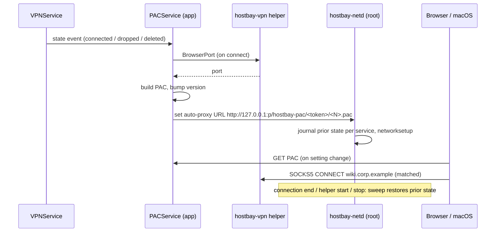
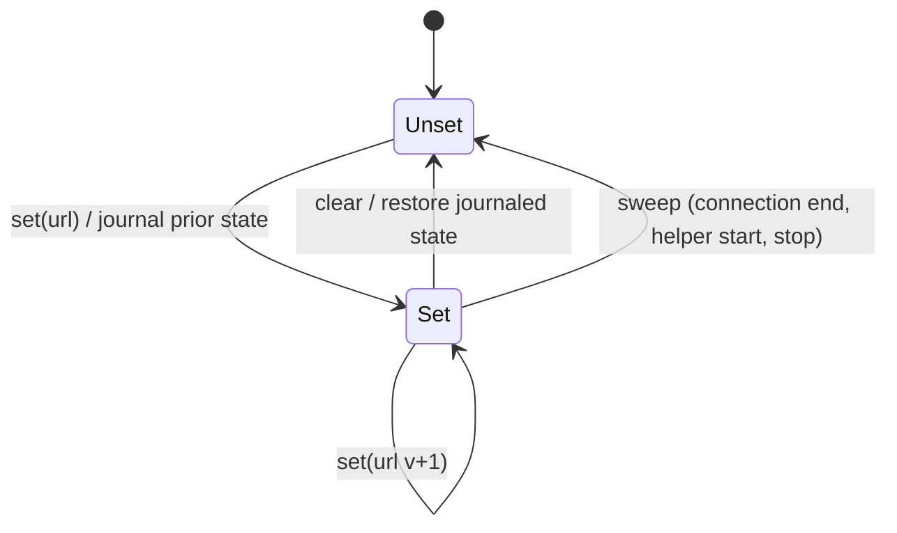

# Route allowlisted domains through a VPN in every browser - Plan

## Goal Capsule

- **Objective:** While a VPN profile is connected, the sites the user allowlisted for it and the VPN's own networks reach that VPN from the user's everyday browsers (Safari, Chrome, Edge, Brave, Firefox), and everything else goes direct, with no separate window, profile or browser extension.
- **Means:** a proxy auto-config (PAC) that Hostbay serves on loopback and the network helper sets as the macOS automatic proxy (KTD1, KTD3), plus host routes for VPNs that have no proxy port (KTD6).
- **Product authority:** the user, in this session. The Product Contract governs behavior; KTDs govern mechanism within it. Windows and Linux are not active scope.
- **Stop conditions:** stop and ask if the U8 manual check shows Safari ignores a `SOCKS5` PAC entry, or that the macOS setting cannot be restored to the user's prior value.
- **Execution profile:** one change set on `main`, one local commit per unit (repo rule), no push without the user's say-so. Delivery shape: one PR if one is opened.
- **Who finishes:** `ce-work` in this session; the user runs the U8 manual browser checks, which need the administrator prompt.
- **Open blockers:** none.

---

## Product Contract

Product Contract preservation: changed R6, R11, R12 — R6 now names IPv4-address requests, since the PAC must not resolve names (KTD2); R11 adds reporting an overriding proxy configuration, which research showed can silently win; R12 keeps the separate browser-profile folders on disk, since deleting them would destroy the user's sign-ins without asking.

### Summary

Each VPN profile gets a list of domains to route through it. Hostbay turns the connected profiles' domains and networks into one system PAC on macOS, so every browser that follows the system proxy sends those sites through the right VPN and the rest direct. The "launch a browser profile through a VPN" feature and its mappings are removed.

### Problem Frame

Today a site reaches an app-scoped VPN from a browser only through a Chrome that Hostbay launches with the VPN's proxy. That Chrome is a second window or a second profile, it refuses to open beside a running Chrome unless Hostbay keeps a signed-out copy of the profile, and Safari and Firefox are not covered at all. A browser extension would not close the gap: Safari web extensions have no proxy API, Chrome installs an extension from outside its store only through developer mode or an administrator policy, and release Firefox installs only signed add-ons. Harmony SASE and system-wide VPNs have no proxy port, so a domain list cannot reach them through a proxy either.

### Key Decisions

- **System PAC on macOS over browser extensions.** One mechanism covers all five browsers, needs nothing installed in them, and does not depend on store listings or signing. Governs R5, R6, R8. (session-settled: user-directed — chosen over Chrome/Firefox extensions and over extensions plus PAC: extensions cannot cover Safari and need developer mode or AMO signing to install)
- **Remove launch-through-VPN.** The PAC replaces it in the user's own browser, so the launcher and its mappings go. Governs R12, R13.
- **A disconnected profile's domains go direct.** They leave the PAC when the profile disconnects, so allowlisted public sites still load; no request is sent to a proxy that is not there. Governs R7.
- **Domains for VPNs without a proxy port become host routes.** Harmony SASE and system-wide profiles carry an allowlisted domain as routes to its current addresses, re-resolved while connected. Governs R9, R10.
- **A domain belongs to one profile.** Two profiles claiming the same domain would make the route depend on order, so saving the second is refused. Governs R3.

### Requirements

**Domain lists**

- R1. Every VPN profile, of any tier, has a list of domains whose traffic goes through it, edited in the profile form and synced with the profile.
- R2. A domain entry covers the domain and all its subdomains (`corp.example` covers `wiki.corp.example`); an entry is a plain DNS name, and anything else is refused when saved.
- R3. Saving a profile whose list holds a domain another profile already lists, or a subdomain of one, is refused naming that profile.
- R4. A profile's own networks (its routes, plus the routes its tunnel pushed when connected) go through it as well as its domains, without the user listing them.

**Browsers through app-scoped VPNs (system PAC)**

- R5. While at least one connected app-scoped profile has domains or networks, Hostbay serves a PAC on loopback and sets it as the macOS automatic proxy configuration for every network service; when none does, it removes that setting.
- R6. The PAC sends each listed domain, and each request to an IPv4 address in a listed network, to the SOCKS listener of the profile that lists it, with no direct fallback for those, and sends everything else direct.
- R7. The PAC follows connects and disconnects within seconds: a profile's entries appear when it connects and leave when it disconnects, drops or is deleted.
- R8. Quitting Hostbay removes the system setting; if Hostbay ends without removing it, browsers that cannot fetch the PAC go direct, and Hostbay removes the stale setting on its next start.

**Domains through VPNs without a proxy port**

- R9. For a connected system-wide or external profile whose routes apply, each listed domain is resolved and routed to its tunnel as host routes, through the same routing plan, preview and auto-apply as its networks.
- R10. Hostbay re-resolves those domains while the profile stays connected, adding routes for new addresses and removing routes for addresses no longer returned.

**Visibility**

- R11. The VPN panel shows, per connected profile, how many domains and networks are routed through it, and Settings shows whether the system proxy is set by Hostbay and warns when another proxy configuration overrides it.

**Removal**

- R12. The browser launch feature is removed: the launch action, the browser-profile mappings and their editor; the separate profile folders Hostbay created stay on disk and the app says where they are.
- R13. Importing a TunnelHub file no longer creates browser mappings; its Chrome entries are listed as skipped with the reason.

### Key Flows

- F1. Reach an internal site from Safari
  - **Trigger:** the user lists `corp.example` on the OD Internal profile and connects it.
  - **Steps:** Hostbay starts the profile's SOCKS listener, serves the PAC and sets the system auto-proxy; Safari asks the PAC for `wiki.corp.example` and gets the listener; `ipinfo.io` gets direct.
  - **Outcome:** the wiki loads through OD Internal; ipinfo.io shows the user's own public address.
  - **Covered by:** R1, R2, R5, R6
- F2. Disconnect
  - **Trigger:** the user disconnects OD Internal while another app-scoped profile stays connected.
  - **Steps:** the PAC drops OD Internal's entries; the system setting stays for the other profile.
  - **Outcome:** `wiki.corp.example` now goes direct; the other profile's sites still go through it.
  - **Covered by:** R5, R7
- F3. A domain through Harmony SASE
  - **Trigger:** the user lists `portal.example` on Harmony SASE, which is connected with auto-apply on.
  - **Steps:** Hostbay resolves `portal.example` and adds host routes to Harmony's tunnel through the routing plan; it re-resolves while Harmony stays up.
  - **Outcome:** `portal.example` goes through Harmony from every app, browsers included.
  - **Covered by:** R1, R9, R10

### Acceptance Examples

- AE1. Covers R3. Given Harmony SASE lists `corp.example`, when the user saves OD Internal with `wiki.corp.example`, the save is refused naming Harmony SASE.
- AE2. Covers R5, R8. Given no app-scoped profile is connected, the system automatic proxy setting is not Hostbay's; given Hostbay crashed with it set, the setting is gone by the time Hostbay starts again.
- AE3. Covers R6. Given OD Internal is connected with network `10.212.0.0/16` and no domains, a request to `10.212.4.5` goes to its listener and a request to `ipinfo.io` goes direct.
- AE4. Covers R10. Given `portal.example` resolved to A and now resolves to B while Harmony is connected, the route to A is removed and a route to B is added.

### Scope Boundaries

- Browser extensions for Chrome, Firefox or Safari (deferred; the PAC covers these browsers without them).
- Windows and Linux system proxy settings (deferred).
- Apps that ignore the system proxy (command-line tools such as curl, some Electron apps) are not covered by R5 and R6.
- Per-browser on/off control.
- Wildcards or patterns other than "domain and its subdomains", and per-path rules.
- IPv6 networks and AAAA records for host routes in R9 (deferred).
- Hostnames that are not listed but resolve into a profile's network are not proxied: the PAC does no DNS (KTD2). List the domain instead.
- Considered and not built: keeping a SOCKS listener bound after its VPN disconnects so the PAC can stay unchanged (research suggestion). It contradicts the settled "disconnected goes direct" decision; revisit if users report allowlisted sites leaking direct while a VPN reconnects.
- Considered and not built: serving the PAC from the root helper so it outlives the app. The helper's sweep removes the setting whenever the app's connection ends (KTD4), so a dead PAC URL never stays set; revisit if the sweep proves unreliable.

### Dependencies / Assumptions

- Setting the macOS automatic proxy needs an administrator, so the privileged network helper gains that operation; existing installs see the helper's administrator prompt once to upgrade it, and users who never installed it are asked to install it when they first connect an app-scoped profile with domains or networks.
- Safari, Chrome, Edge and Brave follow the macOS system proxy; Firefox does by default ("Use system proxy settings"). A Firefox set to its own proxy settings is not covered.
- Other apps that honour the system proxy, such as Mail, also send allowlisted domains through the VPN. This is accepted.
- An app-scoped profile's SOCKS listener is loopback-only and needs no sign-in; other local processes can use it while the profile is connected, as they could during a browser launch before.
- Unverified until U8: Safari honours a `SOCKS5` PAC entry and sends hostnames (not resolved addresses) to the proxy.

### Outstanding Questions

- Deferred to Implementation: the exact re-resolve interval for R10 (KTD7 sets a default) and how a resolution failure is shown.
- Deferred to Implementation: whether names under a listed domain should be resolved through the VPN's own DNS servers; the SOCKS listener already resolves inside the engine for app-scoped profiles.

### Sources / Research

- Current launcher and PAC: `internal/app/vpnbrowser.go`, `internal/vpn/browser/launch.go` (`splitPAC`), `src/components/BrowserMappings.tsx`.
- Helper protocol and journal: `internal/netd/api.go`, `internal/netd/server.go`, `internal/netd/journal.go`, `internal/netd/install.go` (install prompt text).
- Routing plan, preview and auto-apply that R9 extends: `internal/vpn/routing/planner.go`, `internal/app/routing.go`.
- Per-profile no-login SOCKS listener: `internal/vpn/browserport.go`, `cmd/hostbay-vpn/main.go`, `internal/vpn/socks/server.go`.
- Loopback HTTP and its DNS-rebinding guard: `internal/mcp/server.go`, `internal/mcp/middleware.go`.
- Prior VPN plan whose R33 and KTD11 this replaces: `docs/plans/2026-10-30-1022-feat-vpn-profiles-plan.md`.
- External: Chrome and Firefox read a bare `SOCKS` PAC entry as SOCKS v4; no browser re-fetches a PAC whose URL is unchanged (Chrome keeps it up to 12 h); a PAC that cannot be fetched makes browsers go direct, with Chrome backing off to 4 h retries; `networksetup -setautoproxyurl` per enabled service as root; only the primary service's proxy settings apply, so a VPN client or MDM profile can override them (research dossier from this planning run, kept out of the repo).

---

## Planning Contract

### Key Technical Decisions

- KTD1. **The app serves the PAC; the helper only points macOS at it.** A small loopback HTTP server in the app serves the PAC on a random port and an unguessable path, behind the same Host/Origin guard the MCP server uses, so a web page cannot read the domain list or ports. The helper validates that any URL it sets is `http://127.0.0.1:<port>/<path>`. Governs R5.
- KTD2. **The PAC does no DNS.** It matches listed domains by exact name or dot-suffix, matches networks only when the host is an IPv4 literal, and returns exactly `SOCKS5 127.0.0.1:<port>` for a match and `DIRECT` otherwise, in plain ES5. A blocking `dnsResolve` per request would slow every page load, and a `SOCKS` (v4) or `; DIRECT` fallback would leak matched traffic. Governs R2, R6.
- KTD3. **Every PAC change gets a new URL.** Browsers do not re-fetch a PAC at an unchanged URL, so each content change bumps a version in the URL path (`/hostbay-pac/<token>/<N>.pac`, never a query string, which the helper's URL check refuses) and the helper sets the new URL, which browsers and macOS notice as a setting change. Governs R7.
- KTD4. **The helper journals each service's prior proxy state and restores it on sweep.** Before the first change it records, per enabled network service, the prior automatic-proxy URL and state. Sweep restores a service only if it still holds a URL of Hostbay's form (loopback with the `/hostbay-pac/` path, any port or version, since a crash can strand an older version), so the user's own or a corporate PAC comes back and a newer change by someone else is left alone. The sweep already runs at helper start, on connection end and at stop, which gives R8's crash recovery. Governs R5, R8.
- KTD5. **The helper protocol version goes up.** Older helpers reject an unknown operation as invalid, which Hostbay would misread, so the version bump makes the app ask for the helper reinstall first. The install prompt text names the proxy setting. Governs R5.
- KTD6. **Domain host routes are a routing-plan input, not a separate mechanism.** The routing service resolves each listed domain of a connected system-wide or external profile to IPv4 addresses and passes them to the planner as host routes on that profile, so preview, auto-apply, conflict skips and reset behave as they do for networks. Governs R9.
- KTD7. **Re-resolving runs on a 5-minute ticker in the routing service, and the plan removes stale domain routes.** The planner gains the set of host routes Hostbay added for a profile's domains; one no longer wanted is deleted with a reason naming the domain. Five minutes keeps lookups cheap; CDN-backed sites may miss the VPN briefly. Governs R10.
- KTD8. **A new `domains` field on the profile, not `DNSDomains`.** `DNSDomains` already feeds WireGuard's `DNS=` line and SSH host matching, and importers fill it with search domains, so reusing it would change what saved data means and make R3 refuse existing profiles. Governs R1, R3.
- KTD9. **The SOCKS listener port is fetched after each connect.** The app asks the helper for the no-login listener's port when a profile reaches connected, outside the VPN service lock, and rebuilds the PAC. The port changes on every reconnect. Governs R5, R7.
- KTD10. **Conflicts are refused at save and tie-broken at build.** R3 is checked in `SaveVPN` and, since the import review lets the user edit each draft's domains and a refused commit leaves the review open to fix, in import commit too (decided in code review, 2026-11-03); because restore and sync bypass it, the PAC builder and planner also give a domain to the first profile in saved order and report the others as skipped. Governs R3.

### High-Level Technical Design

Component flow when an app-scoped profile with domains connects or disconnects:



PAC decision for one request (directional, not implementation):

```text
host := lowercase(host)
if host matches a listed domain (exact or ".domain" suffix) -> SOCKS5 port of its profile
if host is an IPv4 literal in a network of its profile (R4)  -> SOCKS5 port of the most specific network's profile
otherwise                                                     -> DIRECT
```

Proxy-setting lifecycle in the helper:



### Assumptions

- `networksetup` is available at `/usr/sbin/networksetup` and applies changes immediately; disabled services (`*`-prefixed) and the header line are skipped.
- `scutil --proxy` is readable without root and shows the effective configuration, which the app compares with its own URL for R11's override warning.

### Sequencing

U1 → U2 → U3 → U4 → U5; U6 after U4 (so no release has neither path); U7 after U4 and U5; U8 last.

---

## Implementation Units

### U1. Domain list on the VPN profile

**Goal:** a synced per-profile list of domains, validated and conflict-checked on save.
**Requirements:** R1, R2, R3, AE1; KTD8, KTD10.
**Dependencies:** none.
**Files:**
- `internal/store/vpns.go` (new `Domains` field, strict DNS-name check in `CheckVPN`)
- `internal/app/vpns.go` (DTO field, `vpnToUI`, `SaveVPN` copy and R3 check naming the other profile)
- `internal/app/vpnimport.go` (copy the field on import commit)
- `src/api.ts`, `src/shell/vpnForm.ts`, `src/shell/settings/Vpns.tsx` (editor beside routes), `src/i18n/en.ts`
- `src/bindings/hostbay/internal/app/models.ts` (regenerated)
- Tests: `internal/store/vpns_test.go`, `internal/app/vpns_test.go`, `src/shell/vpnForm.test.ts`
**Approach:**
1. A domain is lowercased, trimmed of a trailing dot, and must be a plain DNS name (labels of letters, digits and hyphens).
2. R3: refuse when an entry equals, or is a subdomain or parent of, an entry on another profile.
3. The form editor follows `RouteEditor` (`TagEditor` with a per-item `bad` predicate).
**Patterns to follow:** `Routes`/`DNSDomains` handling across store, DTO and form.
**Test scenarios:**
- `Corp.Example.` saves as `corp.example`.
- `*.corp.example`, `http://x`, `a b`, `"x"` and an entry with a control character are refused.
- Covers AE1. Saving `wiki.corp.example` while Harmony lists `corp.example` is refused naming Harmony; saving `corp.example` while another lists `wiki.corp.example` is refused too.
- A profile re-saved with its own unchanged list is accepted.
- Import commit keeps a profile's domains.
**Verification:** a domain list round-trips through save, sync data and the form.

### U2. PAC builder

**Goal:** a pure function from connected app-scoped profiles to PAC text.
**Requirements:** R2, R4, R6; KTD2, KTD10.
**Dependencies:** U1.
**Files:**
- `internal/vpn/pac/pac.go` (new), `internal/vpn/pac/pac_test.go`
**Approach:**
1. Input per profile: id, name, SOCKS port, domains, networks (profile routes plus live pushed routes).
2. Domains: exact or suffix match; an overlap that import, restore or sync still creates goes to the most specific (longest) domain, and an exact duplicate to the first profile in saved order, the rest reported as skipped (KTD10).
3. Networks: IPv4 only; most specific prefix wins; a default route and the 0.0.0.0/1 and 128.0.0.0/1 halves do not count, since every hostname already goes direct and a full tunnel would otherwise capture every IPv4 literal on the LAN (decision default, see Deferred / Open Questions).
4. Output contains only validated domains and canonical prefixes, so the script cannot be injected into.
5. Reuse what fits from `splitPAC` in `internal/vpn/browser/launch.go`; drop its DNS and plain-name rules.
**Test scenarios:**
- `wiki.corp.example` and `corp.example` return profile A's `SOCKS5 127.0.0.1:p`; `notcorp.example` returns `DIRECT`.
- Covers AE3. `10.212.4.5` returns OD Internal's proxy; `ipinfo.io` returns `DIRECT`.
- Two profiles with `10.0.0.0/8` and `10.212.0.0/16`: `10.212.1.1` goes to the second.
- A duplicate domain across profiles goes to the first and is reported skipped; with `corp.example` on A and `wiki.corp.example` on B, `wiki.corp.example` goes to B.
- A full-tunnel profile (`0.0.0.0/0`) leaves `192.168.1.1` DIRECT.
- No profile: empty result, and the caller removes the setting.
- The output never contains `SOCKS ` without `5`, `DIRECT` after a proxy, `dnsResolve`, or `myIpAddress`.
- When `node` is on PATH, the generated script is evaluated against a host table (skipped otherwise).
**Verification:** the PAC answers each sample host as the requirements say.

### U3. Helper operation: set and clear the system automatic proxy

**Goal:** hostbay-netd can point every enabled macOS network service at a loopback PAC URL and restore the prior state.
**Requirements:** R5, R8, AE2; KTD1, KTD3, KTD4, KTD5.
**Dependencies:** none.
**Files:**
- `internal/netd/api.go` (tag, `Msg` field, `validate` accepting only `http://127.0.0.1:<port>/<path>`, version bump)
- `internal/netd/server.go` (dispatch, journal before change)
- `internal/netd/journal.go` (proxy entry; sweep restores only if the service still holds Hostbay's URL)
- `internal/netd/proxy_darwin.go` (new; `networksetup` by absolute path and argv), `internal/netd/proxy_other.go` (CodeUnsupported)
- `internal/netd/client.go`, `internal/app/netd.go` (client method and `netdClient` interface), `internal/app/netd_test.go` (fake)
- `internal/netd/install.go` (install prompt text names the proxy setting)
- Tests: `internal/netd/api_test.go`, `internal/netd/server_test.go`, `internal/netd/journal_test.go`, `internal/netd/proxy_darwin_test.go`
**Approach:**
1. Set: list services, skip disabled ones, record each prior URL and state once per connection (before changing it, as route ops journal), then set URL and enable. The URL check accepts only `http://127.0.0.1:<port>/hostbay-pac/<token>/<N>.pac` with a safe token.
2. Clear: restore each journaled service and drop the entries.
3. Sweep: the same restore, newest first; an entry whose service no longer holds a URL of Hostbay's form is dropped without change.
4. The tool runner is injected so tests record argv instead of running `networksetup`.
**Patterns to follow:** route ops in `server.go` (`opMu`, `stopped`), `runTool` in `routes_darwin.go`, `fakeTable` in `fake_test.go`.
**Test scenarios:**
- `https://`, a non-loopback host, `localhost`, a missing port and a URL with a quote are refused by `validate`.
- Set on two enabled services and one disabled: two services set, prior states journaled.
- Covers AE2. Connection end sweeps: a service that held a corporate PAC gets it back; one with none ends disabled.
- A service whose URL someone else changed after Hostbay set it is left alone by sweep.
- A second set with a new version updates the URL without journaling the prior state again; set v1, set v2, then sweep restores the prior state.
- A client of the old version gets CodeVersion.
**Verification:** the helper's tests prove set, clear and sweep restore exactly the journaled state.

### U4. PAC service in the app

**Goal:** the app serves the PAC and keeps the system setting in step with connected profiles.
**Requirements:** R4, R5, R6, R7, R8; KTD1, KTD3, KTD9.
**Dependencies:** U2, U3.
**Files:**
- `internal/app/pac.go` (new service), `internal/app/pac_test.go`
- `internal/app/routing.go` or `internal/app/netd.go` (fan out `onConnect` and VPN-state signals to both routing and PAC)
- `main.go` (register after `NetdService`, so it stops first)
**Approach:**
1. Loopback HTTP on a random port and token path, guarded like `internal/mcp/middleware.go`, content type `application/x-ns-proxy-autoconfig`.
2. Signals (VPN state, profile save/delete, helper connect) only wake a rebuild loop; the loop reads `VPNStates()`, the store and each connected app-scoped profile's `BrowserPort` outside locks.
3. On a content change: bump the version and ask the helper to set the new URL; with no entries, ask it to clear.
4. Helper reconnect re-sets the current URL, since the sweep cleared it.
5. Shutdown asks the helper to clear before the helper connection closes; a crash leaves it to the sweep.
6. A missing or outdated helper leaves the setting unset and exposes that to the UI for U7's prompt.
7. The PAC body, its URL and the SOCKS ports never reach a log, an event, the UI or MCP (as `internal/vpn/browserport.go` requires of the port).
**Patterns to follow:** `RoutingService` signal wrapping of `vpns.emit` and its rebuild loop; `mcp.Server` start and stop.
**Test scenarios:**
- Connecting a profile with a domain serves a PAC containing it and sets the URL once.
- Disconnecting it while another profile stays connected sets a new URL whose PAC lacks it (F2).
- Disconnecting the last one clears the setting.
- A request with a foreign Host or any Origin header is refused.
- Helper reconnect re-sets the same content.
- Shutdown clears before the helper client closes.
- A reconnect that changes the SOCKS port produces a new URL and PAC.
**Verification:** with fakes for the helper and VPN states, the system-setting calls follow connect and disconnect exactly.

### U5. Domain host routes for system-wide and external profiles

**Goal:** listed domains of connected Harmony-like and system-wide profiles become host routes, kept current.
**Requirements:** R9, R10, F3, AE4; KTD6, KTD7, KTD10.
**Dependencies:** U1.
**Files:**
- `internal/vpn/routing/planner.go` (profile domain addresses as wants; deletions of stale domain routes Hostbay added)
- `internal/app/routing.go` (resolve with the injected resolver, IPv4 only, 5-minute ticker kick, track added domain routes)
- Tests: `internal/vpn/routing/planner_test.go`, `internal/app/routing_test.go`
**Approach:**
1. Resolve each domain of each connected system or external profile when it connects and on the 5-minute ticker, outside the apply lock, into a per-profile cache that `plan()` only reads; `plan()` never resolves domains, so route events do not re-resolve. Keep only IPv4 results that are global unicast and not a connected profile's gateway endpoint; report the rest as skips naming the domain.
2. Each address becomes a host route on the profile's tunnel with a reason naming the domain.
3. A previously added domain route no longer wanted becomes a delete.
4. App-scoped profiles are untouched; their domains go through the PAC.
**Patterns to follow:** the injected `resolve` in `RoutingService`; `dedupe` and skip reasons in `Build`.
**Test scenarios:**
- Harmony connected with `portal.example` resolving to A: the plan adds `A/32` on its tunnel.
- Covers AE4. The resolver now returns B: the next plan deletes `A/32` and adds `B/32`.
- An IPv6-only answer adds nothing; an answer of `0.0.0.0` or `127.0.0.1`, or a profile's gateway, adds no route and is reported skipped.
- A route event between ticks does not call the resolver and changes no domain route.
- A resolution failure keeps existing routes and reports a skip.
- A disconnected profile's domains are skipped as not connected.
- The preview shows domain routes with their domain in the reason.
**Verification:** routing tests show domain routes added, moved and removed through the normal apply path.

### U6. Remove the browser launcher

**Goal:** the launch feature and mappings are gone; the SOCKS listener plumbing stays for the PAC.
**Requirements:** R12, R13; Key Decision "Remove launch-through-VPN".
**Dependencies:** U4.
**Files:**
- Delete: `internal/app/vpnbrowser.go`, `internal/app/vpnbrowser_test.go`, `internal/vpn/browser/` (after U2 took what it needed), `internal/store/browsermappings.go`, `src/components/BrowserMappings.tsx`, `src/components/BrowserMappings.test.tsx`
- Modify: `internal/store/settings.go` (drop `BrowserMappings`), `internal/app/vpns.go` (`DeleteVPN` cleanup), `internal/app/vpnimport.go`, `internal/importer/restore.go`, `internal/importer/tunnelhub/import.go` and its test (Chrome entries skipped), `src/components/VpnPanel.tsx`, `src/api.ts`, `src/importApi.ts`, `src/components/VpnImport.tsx`, `src/i18n/en.ts`, regenerated bindings
- Docs: note in `docs/plans/2026-10-30-1022-feat-vpn-profiles-plan.md` that R33 and KTD11 are superseded by this plan
**Approach:**
1. Keep `OpenBrowser`/`BrowserPort`, `Helper.BrowserPort` and the no-login SOCKS listener.
2. Leave `<data folder>/browsers/` on disk; the VPN panel shows a one-line notice with the path while that folder exists.
3. Saved `browserMappings` in local settings are ignored on load.
**Test scenarios:**
- Covers R13. A TunnelHub file with a Chrome entry imports its VPNs and lists the entry as skipped with the reason.
- Local settings containing old `browserMappings` load without error.
- The VPN panel renders without the browser-profiles section and shows the folder notice only when the folder exists.
**Verification:** no reference to the launcher remains (`LaunchBrowser`, `BrowserMapping`), and all suites pass.

### U7. Visibility and helper prompt

**Goal:** the user can see what is routed and whether the system proxy is Hostbay's.
**Requirements:** R11.
**Dependencies:** U4, U5.
**Files:**
- `internal/app/pac.go` (status: set, not set, needs helper, overridden), `src/api.ts`, `src/components/VpnPanel.tsx` (per-profile counts), a Settings VPN or network section, `src/shell/useHelperPrompt.ts`, `src/i18n/en.ts`
- Tests: `internal/app/pac_test.go`, `src/components/VpnPanel.test.tsx`
**Approach:**
1. Counts per connected profile: domains plus networks, shown only while they are in effect (PAC set and not overridden, or host routes applied); otherwise the row says routing is not in effect and why (helper needed, overridden, awaiting apply).
2. Override check: read the effective configuration with `scutil --proxy` and compare with Hostbay's URL.
3. When the helper is missing or outdated and an app-scoped profile with entries connects, ask to install it then, extending `useHelperPrompt` to the missing state; declining leaves the VPN connected with the row showing that routing needs the helper.
**Test scenarios:**
- A connected profile with 2 domains and 3 networks shows "2 domains, 3 networks".
- An effective proxy configuration naming another URL shows the override warning.
- An outdated helper status triggers the reinstall prompt once.
- With the helper missing, a connected profile with entries shows that routing needs the helper instead of counts.
**Verification:** status text follows the fake service's states.

### U8. Manual browser checks

**Goal:** prove the browser behaviors research could not.
**Requirements:** R5, R6, R8; F1, F2.
**Dependencies:** U1 to U7, installed build.
**Files:** none.
**Approach:** with OD Internal connected and `ipinfo.io` plus an internal domain listed, check in Safari, Chrome and Firefox:
1. The listed domain loads through the VPN (it shows the VPN's exit address).
2. An unlisted site goes direct.
3. Disconnecting makes the listed public domain go direct within seconds.
4. Quitting Hostbay restores the prior proxy setting.
5. Safari sends the hostname to the proxy (a name only the VPN's DNS knows still loads).
6. With Harmony SASE connected alongside OD Internal, `scutil --proxy` still shows Hostbay's URL, checks 1 and 2 still pass in Safari and Chrome, and a domain listed on Harmony loads through Harmony's exit address.
**Execution note:** the user runs these after the administrator prompt; report each result, and stop per the Goal Capsule if Safari ignores `SOCKS5`.
**Test expectation:** none -- manual runtime verification of browser behavior.
**Verification:** each check passes, or its failure is recorded with the browser and macOS version.

---

## Verification Contract

- `go test ./...` passes; `go vet ./...` is clean; `gofmt -l internal cmd` lists nothing.
- `npx tsc --noEmit` and `npx vitest run` pass.
- Bindings regenerated with `~/go/bin/wails3 generate bindings -d src/bindings -clean=true -ts -i`; the untracked `src/bindings/github.com/wailsapp/wails/v3/pkg/` directory stays uncommitted.
- `~/go/bin/wails3 task darwin:package` builds; the installed app passes U8.

## Definition of Done

- Every unit's verification holds and its tests are in the repo.
- No reference to the browser launcher remains, and no dead code from abandoned attempts is left in the diff.
- The helper reinstall prompt names the proxy setting, and the app recovers the system proxy setting after a crash (AE2).
- U8 results are reported to the user, including any browser that did not behave as planned.

## Deferred / Open Questions

### From 2026-11-03 review

- Decision default applied (U2): a full-tunnel app-scoped profile's default route is not a PAC network, so LAN addresses typed as IPv4 literals stay direct. Revisit if the user wants a full tunnel to capture every IPv4 literal.
- Needs the user's confirmation: every connected app-scoped profile with domains or networks now keeps its no-login SOCKS listener open while connected (before, only after a browser launch), reachable by any local process or other macOS user through the machine-wide PAC. The Dependencies assumption understates this. Default kept: proceed per R4/R5; if declined, limit PAC entries and the listener to profiles that list a domain.
- Not built: warning when Hostbay's PAC replaces a prior user or corporate PAC or manual proxy (unlisted traffic goes direct while connected). The helper journals the prior state, so the status could report it later.
- Not added: a Safari SOCKS5 spike before U1; the stop condition stays at U8, and the launcher removal (U6) stays revertable from git history.
- Residual: IPv6-capable networks reach a dual-stack listed domain over IPv6 outside the tunnel (R9 defers AAAA); a fixed 5-minute re-resolve can miss short-TTL CDN answers.

