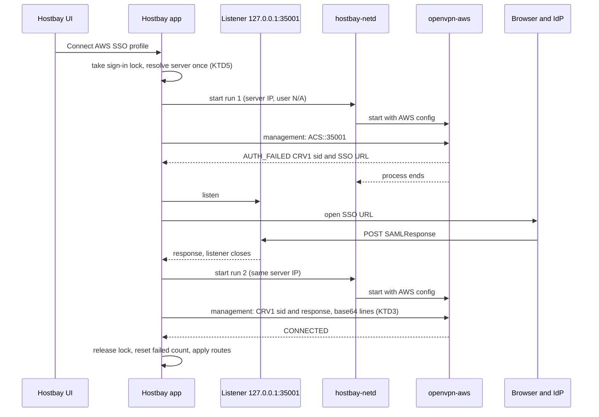
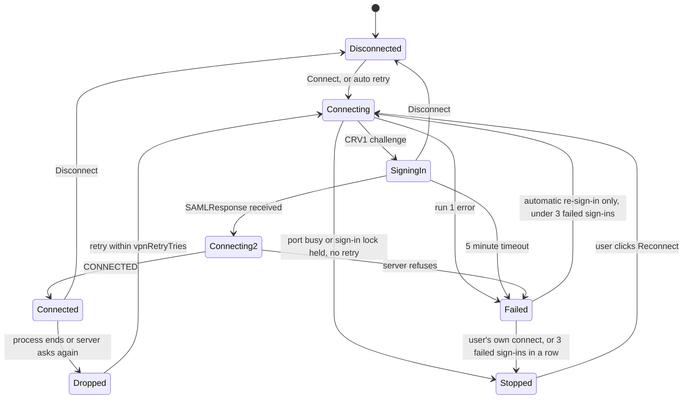

# AWS Client VPN with SSO sign-in - Plan

## Goal Capsule

- **Objective:** staff connect to an AWS Client VPN endpoint that uses SSO (SAML) sign-in from Hostbay on macOS, Windows and Linux, signing in through their own browser, with no AWS VPN Client installed.
- **Means:** an AWS SSO profile kind that runs system-wide on a Hostbay-built patched OpenVPN, used for AWS SSO profiles only (KTD1, KTD4).
- **Authority:** this plan's Requirements win on behaviour and its KTDs win on mechanism. The 2026-10-30 VPN profiles plan (`docs/plans/2026-10-30-1022-feat-vpn-profiles-plan.md`) governs everything this plan does not change. For AWS SSO profiles only, this plan overrides the 2026-11-15 plan's boundary that browser sign-in stays app-scoped (`docs/plans/2026-11-15-1247-feat-macos-system-wide-openconnect-plan.md`).
- **Stop conditions:**
  - Stop if a change would let the SAML response reach a log, an error, a file the helper writes, or the UI (R6).
  - Stop if the helper would run a client binary a non-root user can write (`internal/netd/auth.go` ownership check).
  - Stop if the 35001 listener would accept a request from anywhere but loopback (R5).
- **Execution profile:** one delivery, committed per unit on `main`, pushed only when the user asks (user's standing rule).
- **Finishing:** `ce-work` builds and verifies each unit. The user reinstalls the helper (one admin prompt) and runs the live sign-in once an AWS `.ovpn` is available.

---

## Product Contract

### Summary

Hostbay recognises an AWS Client VPN `.ovpn` that uses SSO and connects it natively. One connect runs a Hostbay-built patched OpenVPN twice, once to fetch the SSO page and once with the user's sign-in, which Hostbay catches on `127.0.0.1:35001` from the default browser. Release builds ship that patched OpenVPN for macOS, Windows and the Linux .deb/.rpm packages. Other OpenVPN profiles are unchanged.

### Problem Frame

Some corporate networks sit behind AWS Client VPN endpoints that sign users in through SSO. The only supported way onto them is AWS's own VPN Client app, which the user does not want to install beside Hostbay.

Hostbay cannot connect these endpoints today. Its import drops `auth-federate` and refuses `remote-random-hostname` at connect (`internal/importer/vpnconf/ovpn.go`, `internal/vpn/openvpn/config.go`). Its management code answers one password request, hides the CRV1 challenge behind a fixed message and ends the run on a second request (`internal/vpn/openvpn/manage.go`).

Stock OpenVPN cannot complete the sign-in either. The SAML response is about 6 to 12 KB. OpenVPN 2.7 sends the password through a 2048-byte TLS control buffer (`common.h:70`) and caps it at 4096 bytes (`misc.h:64-67`), so the second connect fails at about 1.5 KB. AWS states that OpenVPN-based clients cannot connect to SAML endpoints. Every open-source client that does it ships a patched OpenVPN.

Product Contract preservation: changed R11 (Linux limited to the .deb and .rpm installs, chosen by the user during planning) and R13 (pins the current OpenVPN 2.7 release instead of 2.7.8, a clarification after 2.7.9 shipped security fixes). Added R15 and R16 from the planning synthesis the user confirmed. Other IDs unchanged.

### Key Decisions

- **Ship a patched OpenVPN instead of relying on the AWS VPN Client.** (session-settled: user-directed — chosen over keeping the AWS VPN Client for SSO endpoints: the user does not want to install it.) Governs R4, R13.
- **The patched OpenVPN serves AWS SSO profiles only.** (session-settled: user-directed — chosen over one patched OpenVPN for every OpenVPN profile, and over an embedded sign-in window: a patch bug can then break only AWS SSO.) Governs R12.
- **Sign-in runs in the user's default browser.** It reuses the IdP's existing session, so a reconnect is usually one click. The embedded sign-in window exists only on macOS. Governs R4.
- **All three platforms are built together, with no macOS-first spike.** (session-settled: user-directed — chosen over proving the sign-in on macOS before building Windows and Linux.) Governs R11. Conflict: Windows and Linux bundle no OpenVPN today, and the first live test against a real endpoint comes only after all three are built.
- **Linux support means the .deb and .rpm installs.** (session-settled: user-directed — chosen over making the AppImage install the helper: the AppImage cannot install it today.) Governs R11.
- **A dropped tunnel signs in again by itself.** (session-settled: user-directed — chosen over a Reconnect button the user clicks, and over staying disconnected.) Governs R9.
- **Guard the automatic sign-in against a flood of browser windows.** A flaky network would otherwise open a window on every drop. Governs R10, R15, R16.
- **Browser sign-in runs on a system-wide profile.** OpenVPN runs only system-wide through `hostbay-netd`, so AWS SSO cannot be app-scoped. Governs R2, R4.

### Requirements

**Profile and import**

- R1. Importing an AWS Client VPN `.ovpn` that carries `auth-federate` creates an AWS SSO profile without the user choosing a type.
- R2. An AWS SSO profile runs system-wide through the helper, and its listed sites and networks route through it as they do for other system-wide profiles.
- R3. Both connects of one sign-in reach the same AWS server, even when the endpoint uses `remote-random-hostname`.

**Sign-in**

- R4. Connecting opens the user's default browser at the endpoint's SSO page, and the tunnel comes up once the IdP returns the user, with no AWS VPN Client installed.
- R5. Hostbay receives the sign-in on `127.0.0.1:35001` only, accepts one response per sign-in, and stops listening when that sign-in ends.
- R6. The SAML response is treated as a credential: never logged, saved, or shown in an error.
- R7. When port 35001 is already in use, the connect fails with a message naming the app that holds it where the operating system can tell.
- R8. A sign-in nobody finishes times out after 5 minutes and leaves the profile disconnected with that reason shown.
- R16. Only one AWS sign-in runs at a time; a second AWS SSO profile that connects meanwhile fails with a message that another sign-in is in progress.

**Reconnect**

- R9. When an AWS SSO tunnel drops or the network changes, Hostbay reconnects and opens the browser sign-in without the user clicking.
- R10. Hostbay never opens a second sign-in while one is waiting, and after 3 failed sign-ins in a row it stops and shows a Reconnect button.
- R15. A sign-in counts as failed when it times out or the server refuses it, and the count resets once the tunnel comes up.

**Patched OpenVPN and platforms**

- R11. AWS SSO profiles connect on macOS, Windows, and Linux installed from the .deb or .rpm package; the AppImage shows the profile with a message to use those packages.
- R12. Only AWS SSO profiles use the patched OpenVPN; every other OpenVPN profile keeps the binary it uses today.
- R13. Hostbay builds the patched OpenVPN from the current upstream OpenVPN 2.7 release (2.7.9 at planning) plus its own patch on all three platforms, and the helper installs and runs it as it does the current binary.
- R14. Every release that ships the patched OpenVPN publishes its source, the patch and the build scripts, and NOTICE describes it as modified.

### Key Flows

- F1. First connect
  - **Trigger:** the user clicks Connect on an AWS SSO profile.
  - **Steps:** Hostbay picks one AWS server for this sign-in; the first connect returns the SSO challenge; Hostbay starts listening on `127.0.0.1:35001` and opens the browser; the user signs in; the response arrives; Hostbay connects again to the same server with it; the tunnel comes up and its routes apply.
  - **Covered by:** R2 to R6, R8, R16.
- F2. Drop and sign in again
  - **Trigger:** the tunnel drops or the network changes.
  - **Steps:** Hostbay marks the profile reconnecting and runs F1 without a click, unless a sign-in is already waiting or 3 sign-ins in a row have failed.
  - **Covered by:** R9, R10, R15.

### Acceptance Examples

- AE1. **Covers R7.** Given the AWS VPN Client is running and holds port 35001, when the user connects an AWS SSO profile, then the connect fails with a message naming the AWS VPN Client, and no browser opens.
- AE2. **Covers R10.** Given a sign-in window is open and waiting, when the network changes again, then no second browser window opens.
- AE3. **Covers R10, R15.** Given 3 sign-ins in a row have failed or timed out, when the tunnel drops again, then Hostbay opens no browser and shows the profile with a Reconnect button.
- AE4. **Covers R12.** Given an ordinary OpenVPN profile without `auth-federate`, when it connects, then it runs on the same OpenVPN binary as before this change.
- AE5. **Covers R8.** Given the browser opened and the user closed it without signing in, when 5 minutes pass, then the profile is disconnected with a reason saying the sign-in was not completed.
- AE6. **Covers R6.** Given a sign-in fails at the second connect, then the error and the logs carry no part of the SAML response.
- AE7. **Covers R16.** Given profile A is waiting for its sign-in, when the user connects AWS SSO profile B, then B fails with a message that another sign-in is in progress, and A keeps waiting.

### Scope Boundaries

- AWS endpoints that use certificate-only sign-in. They may already work as plain OpenVPN profiles; this is unverified.
- Downloading the `.ovpn` from AWS's self-service portal.
- Detecting a running AWS VPN Client app as an external VPN.
- An app-scoped AWS SSO profile.
- An embedded sign-in window on any platform.
- Moving ordinary OpenVPN profiles onto the patched OpenVPN.
- AWS SSO from the Linux AppImage.
- Considered and not built:
  - A desktop notification when an automatic sign-in opens or gives up. The VPN list and tray already show the state and a Reconnect button. Build it if users report missing an overnight give-up.
  - Matching the SAML response's `InResponseTo` to the request. The listener closes when its sign-in ends, and AWS rejects a response for the wrong session. Build it if a stale response is ever accepted.
  - A network-change watcher for system-wide OpenVPN. OpenVPN's own ping timeout ends the run on a network change and R9 takes over. Build it if drops go unnoticed for longer than the ping timeout.
  - Shipping OpenVPN's Windows interactive service (`openvpnserv.exe`). The helper creates the adapter itself (KTD7), which avoids another privileged service.

#### Deferred to Follow-Up Work

- Applying DNS servers the AWS endpoint pushes. This gap already exists for every system-wide OpenVPN profile. Until it closes, private AWS hostnames resolve only through Sites or DNS configured elsewhere.
- Authenticode-signing the Windows OpenVPN binaries, once the project has a Windows signing certificate.

### Dependencies / Assumptions

- No AWS `.ovpn` is available yet, so nothing has been tested against a live endpoint.
- AWS supports only its own client for SAML sign-in and may change server behaviour without notice.
- The endpoint's IdP application sends the sign-in to `http://127.0.0.1:35001`, AWS's default.
- Hostbay releases are public GitHub Releases (`docs/release-signing.md`), so shipping a modified OpenVPN is GPLv2 distribution.
- An AWS session lasts up to 24 hours by default; after it ends the server asks for a fresh SAML sign-in, which R9 handles as a drop.

### Sources / Research

- OpenVPN 2.7 limits: `src/openvpn/misc.h:64-67` (`USER_PASS_LEN`), `src/openvpn/common.h:70` (`TLS_CHANNEL_BUF_SIZE`), `src/openvpn/ssl.c:2188` (auth write failure), `src/openvpn/manage.c:1041-1121` (multi-line password input), `src/openvpn/options.c:5262` (unknown option is fatal).
- AWS: SAML endpoints need the AWS-provided client, https://docs.aws.amazon.com/vpn/latest/clientvpn-user/connect.html and https://docs.aws.amazon.com/vpn/latest/clientvpn-admin/federated-authentication.html.
- Protocol walkthrough and SAMLResponse size (about 11 KB): https://smallhacks.wordpress.com/2020/07/08/aws-client-vpn-internals/.
- Reference patches for 2.4.9, 2.5.1 and 2.6.12: https://github.com/aws-vpn-client/aws-vpn-client.
- OpenVPN 2.7 on Windows uses ovpn-dco-win and dropped Wintun: OpenVPN `Changes.md` v2.7.0; driver https://github.com/OpenVPN/ovpn-dco-win (MIT, upstream-signed); build tooling https://github.com/OpenVPN/openvpn-build.

---

## Planning Contract

### Key Technical Decisions

- KTD1. **A second client binary, `openvpn-aws`, statically linked.** The helper installs it beside the existing `openvpn` and runs it only for AWS SSO profiles. Static OpenSSL, LZO and LZ4 (no PKCS#11) keep its libraries from overwriting the existing OpenVPN's dylibs, which share one `Frameworks` folder by file name (`build/darwin/bundle-openconnect.sh:86-89`). Governs R12, R13.
- KTD2. **The patch changes three things in upstream OpenVPN 2.7.9.** It raises `USER_PASS_LEN` to `(1 << 17)` in both `ENABLE_PKCS11` branches and `TLS_CHANNEL_BUF_SIZE` to `(1 << 18)`. It also carries the key-method-2 u16-to-u32 length change that every working AWS patch has (2.4.9, 2.5.1, 2.6.12), since the AWS server may check for it. Macros are parenthesised; the AWS patch's bare `1 << 17` breaks `USER_PASS_LEN - 1`. The `OPTION_*`, `manage.c` buffer and `ERR_BUF_SIZE` changes are not needed because KTD3 sends the password another way.
- KTD3. **The SAML password goes in through OpenVPN's multi-line base64 management input.** OpenVPN 2.7.2 and later accept `password "Auth"`, base64 lines of up to 1024 bytes, then `END`, after the client sends `version 6`. It avoids a password file the helper would have to write and keeps the SAML response out of the helper (R6).
- KTD4. **One connect attempt runs OpenVPN twice.** Run one sends user `N/A` and password `ACS::35001`. The server replies AUTH_FAILED carrying `CRV1:R:<sid>:<b64 user>:<url>`, and with `auth-retry none` the process ends. Run two is a new helper tunnel to the same server IP with password `CRV1::<sid>::<url-escaped SAMLResponse>`. The browser wait sits between the runs, outside the 90-second `openvpnConnectWait` (`internal/app/vpnsystem.go:66`), under its own 5-minute timer (R8). Governs R3, R4, R8.
- KTD5. **Hostbay resolves the server once per sign-in.** For `remote-random-hostname`, the app prefixes the endpoint with random hex as AWS's client does, resolves it once, and passes the address as `Remote` to both runs. `Build` already accepts an IP `Remote` (`internal/vpn/openvpn/config.go:89-90`). Governs R3.
- KTD6. **An AWS SSO profile is `Type: openvpn` with `Auth: browser`.** Import sets that pair when the file carries `auth-federate`, and sets `AutoReconnect` on so R9 runs through the existing retry loop. `SecretAAD` binds `Type` but not `Auth` (`internal/store/vpns.go:178-180`), so saved secrets keep opening. The profile editor offers only password and certificate for OpenVPN today (`src/shell/vpnForm.ts:63-67`), so U9 makes it keep browser sign-in for these profiles. Governs R1, R9. (session-settled: user-directed — inherits the decision to sign in again automatically, chosen over a Reconnect button the user clicks.)
- KTD7. **On Windows, the installer adds ovpn-dco-win and the helper creates the adapter.** OpenVPN 2.7 dropped Wintun. NSIS installs the upstream-signed driver with `pnputil`. Before each run the helper ensures an `ovpn-dco` adapter exists with `tapctl` and passes `dev-node`, so `openvpnserv.exe` is not needed. Governs R11.
- KTD8. **The sign-in listener is a separate loopback server with its own guard.** It binds `127.0.0.1:35001` only while a sign-in waits. It accepts a POST with `Host` `127.0.0.1:35001` and a non-empty `SAMLResponse`, with a 256 KB body cap. It accepts an `Origin` header, because the IdP's form post carries one; `pacGuard` (`internal/app/pac.go:193`) refuses those, so it is not reused. A process-wide lock gives one sign-in at a time. Governs R5, R6, R16.
- KTD9. **The port holder is looked up best effort without new dependencies.** On macOS and Linux it parses `lsof -nP -iTCP:35001 -sTCP:LISTEN -Fpc` when `lsof` is installed, which some Linux systems lack. On Windows it uses `GetExtendedTcpTable` and the owning process image through `golang.org/x/sys/windows`, already a dependency. When the lookup fails, the message says the port is in use without a name. Governs R7.
- KTD10. **The helper protocol moves to version 7.** `openvpn.Profile` gains a flag that selects `openvpn-aws` and an AWS-shaped config. `netd.Version` is bumped so an older helper prompts a reinstall (`internal/netd/api.go:32-39`), which also copies the new client in (`internal/netd/install.go:368`). Governs R13.
- KTD11. **Releases attach the OpenVPN source bundle.** Each release that ships `openvpn-aws` attaches, per platform, an archive holding the upstream OpenVPN tarball, the verified source tarball of every statically linked library (OpenSSL, LZO, LZ4, and libcap-ng on Linux), the patch and the build scripts. NOTICE replaces "unmodified" for this binary with a modified-OpenVPN entry pointing at that archive. Governs R14.

### High-Level Technical Design

Sign-in sequence for one connect attempt (F1):

Profile states for an AWS SSO profile (R8, R9, R10, R15, R16):

### System-Wide Impact

- **Helper reinstall for everyone.** KTD10's version bump makes every existing install prompt for one admin reinstall on the next system-wide VPN connect, AWS user or not.
- **MCP `connect_vpn`.** An agent connecting an AWS SSO profile gets the existing `signing_in` state with `need` set to browser sign-in (`internal/mcp/vpn.go:61,87`). The browser opens on the user's machine, so the agent tells the user and polls `vpn_status`, as it does for AnyConnect browser sign-in today. No MCP change is needed.
- **Tray and VPN panel.** Both already show "Waiting for sign-in in the browser" with a re-open button for browser sign-in (`internal/app/tray.go:59-65`, `src/components/VpnPanel.tsx:133-152`); U7 reuses that state.
- **Routing.** A connected AWS SSO tunnel labels its interface like any system-tier profile (`internal/app/routing.go:423`), so Sites and networks apply with auto-apply on.

### Assumptions

- The AWS server accepts the multi-line base64 password from a patched 2.7.9 the same way it accepted the AWS 2.6.12 patch's single-line form.
- Homebrew-style OpenSSL 3, linked statically, accepts AWS's certificate chain without the OpenSSL patch the aws-vpn-client project ships.
- OpenVPN 2.7.9's `tapctl` can create an `ovpn-dco` adapter when the helper runs as SYSTEM.
- AWS pushes an `auth-token`, or does not renegotiate within a session, so a renegotiation under `auth-nocache` does not ask for the password again. If it does, each renegotiation (OpenVPN's default is hourly) ends the run and R9 opens a new sign-in.

### Risks

- **The first live test comes after all three platforms are built.** A wrong assumption above surfaces late. The patch and build scripts stay in one folder so a fix is a single rebuild.
- **AWS may change server behaviour.** AWS calls OpenVPN-based SAML clients unsupported. The failure would show as a refused second connect, which R15 counts and R10 stops.
- **A new kernel driver on Windows.** ovpn-dco-win is upstream-signed, so installation needs no test signing, but it adds a driver to every Windows install.
- **Unsigned Windows binaries.** Without Authenticode, SmartScreen or endpoint protection may flag `openvpn-aws.exe` and `tapctl.exe`.

---

## Implementation Units

### U1. Patched OpenVPN source and build scripts

- **Goal:** a reproducible build of `openvpn-aws` from upstream OpenVPN 2.7.9 plus Hostbay's patch on each platform.
- **Requirements:** R13; KTD1, KTD2.
- **Dependencies:** none.
- **Files:**
  - `build/openvpn-aws/openvpn-2.7.9-aws.patch` (new)
  - `build/openvpn-aws/versions.env` (new: OpenVPN, OpenSSL, LZO, LZ4 and, for Linux, libcap-ng versions and SHA-256s)
  - `build/openvpn-aws/build.sh` (new: macOS and Linux, static link; on macOS builds arm64 and x86_64 and joins them with `lipo -create`, since the app ships as `macos-universal`)
  - `build/openvpn-aws/build.ps1` (new: Windows, MSVC with vcpkg `x64-windows-static`, also outputs `tapctl.exe`)
  - `build/openvpn-aws/README.md` (new: how to rebuild and rebase the patch)
- **Approach:**
  1. Download each tarball and verify its SHA-256 from `versions.env` before unpacking.
  2. Apply the patch with a strict apply that fails on fuzz, so a point release that moves the code stops the build.
  3. Configure without PKCS#11 and with static OpenSSL, LZO and LZ4.
  4. Rename the output to `openvpn-aws` (`openvpn-aws.exe` on Windows).
- **Execution note:** mostly packaging; prove it with a smoke run of each built binary, not unit tests.
- **Patterns to follow:** the pinned-SHA fetch of Wintun and OpenConnect in `.github/workflows/release.yml:65-100`.
- **Test scenarios:**
  - The built binary runs `--version` and reports 2.7.9.
  - A tarball whose SHA-256 differs from `versions.env` stops the build before unpacking.
  - On macOS, `otool -L` on the binary lists only system libraries and `lipo -archs` lists both `arm64` and `x86_64`; on Linux, `ldd` lists only glibc libraries.
- **Verification:** each platform's script produces a binary that passes the smoke checks, and the patch applies cleanly to the pinned tarball.

### U2. Release packaging, driver install and licence notices

- **Goal:** every release carries `openvpn-aws` for each platform, the Windows driver, and the source bundle.
- **Requirements:** R11, R13, R14; KTD1, KTD7, KTD11.
- **Dependencies:** U1.
- **Files:**
  - `.github/workflows/release.yml` (build `openvpn-aws` per runner; each runner uploads its source archive as its own artifact, `openvpn-aws-src-<version>-<os>.tar.gz`, outside the `hostbay-*` pattern; the release job adds them to `release/` after the sign job and before `SHA256SUMS`)
  - `build/darwin/Taskfile.yml` (copy the static binary to `Contents/MacOS/openvpn-aws`, ad-hoc sign, notices folder)
  - `build/windows/nsis/project.nsi` (install `openvpn-aws.exe`, `tapctl.exe`, the ovpn-dco-win driver files; run `pnputil /add-driver ovpn-dco.inf /install`; remove on uninstall)
  - `build/linux/nfpm/nfpm.yaml` (ship `/usr/local/bin/openvpn-aws` in deb and rpm)
  - `NOTICE` (modified-OpenVPN entry; ovpn-dco-win MIT entry)
- **Approach:**
  1. Fetch the ovpn-dco-win release zip by pinned SHA-256, as Wintun is fetched today.
  2. Keep the existing Homebrew `openvpn` bundling unchanged (R12).
  3. Write the source archive in the same job that builds, so it always matches the shipped binaries. It stays out of the signed manifest because `cmd/sign-manifest` refuses any file not named as a Hostbay release asset.
- **Execution note:** packaging; verify with a release dry run on each runner and by installing the Windows package on a test machine.
- **Patterns to follow:** `bin/openconnect-windows` staging and `File /nonfatal` in `project.nsi:102-105`; Wintun's licence-beside-DLL entry in `NOTICE:147-151`.
- **Test scenarios:**
  - Test expectation: none -- packaging and notices; covered by the release dry run and the install check in Verification.
- **Verification:**
  - The release dry run produces a macOS app containing `Contents/MacOS/openvpn-aws`, a Windows installer containing `openvpn-aws.exe`, `tapctl.exe` and the driver, and deb and rpm packages containing `/usr/local/bin/openvpn-aws`.
  - The release lists one `openvpn-aws-src-<version>-<os>.tar.gz` per platform, `SHA256SUMS` covers them, and manifest signing still succeeds with a test key.
  - After installing on Windows, `pnputil /enum-drivers` lists ovpn-dco.

### U3. Helper: second client, AWS config and Windows adapter

- **Goal:** the helper installs, checks and runs `openvpn-aws` for profiles flagged as AWS SSO, with an AWS-shaped config.
- **Requirements:** R2, R3, R12, R13; KTD1, KTD5, KTD7, KTD10.
- **Dependencies:** none (U2 supplies the binary in releases; tests use the fake client).
- **Files:**
  - `internal/netd/api.go` (Version 7)
  - `internal/netd/install.go` (`vpnClients` adds `openvpn-aws`; Windows also copies `tapctl.exe`)
  - `internal/netd/tunnel/openvpn.go` (pick the client by the profile flag; on Windows ensure the adapter and pass its name)
  - `internal/netd/tunnel/tunnel.go` (`childEnv` takes the chosen client's folder)
  - `internal/netd/tunnel/dco_windows.go` (new: ensure the `ovpn-dco` adapter with `tapctl`)
  - `internal/vpn/openvpn/config.go` (AWS flag on `Profile`; `Build` writes the AWS config)
  - Tests: `internal/netd/tunnel/tunnel_test.go`, `internal/netd/install_test.go`, `internal/netd/server_test.go`, `internal/vpn/openvpn/config_test.go`
- **Approach:**
  1. With the AWS flag, `Build` requires an IP `Remote`, drops `auth-federate` and `remote-random-hostname`, and writes `auth-user-pass`, `auth-retry none`, `auth-nocache` and `dns-updown disable`. The last keeps OpenVPN 2.7 from running its compiled-in DNS script as root when AWS pushes DNS, a script the helper never ownership-checks.
  2. The rest of the allowlist is unchanged.
  3. `CheckClient` and `ClientPath` take the client name the flag selects; ownership checks stay as they are.
  4. The ordinary OpenVPN path keeps `openvpn` (R12).
- **Patterns to follow:** `fakeProc` and `newEnv` in `internal/netd/tunnel/tunnel_test.go:36-108`; `TestBuildAcceptsWhatImportKeeps` in `config_test.go:133`.
- **Test scenarios:**
  - An AWS-flagged start runs the `openvpn-aws` path with `--config`; an unflagged start runs `openvpn`. Covers AE4.
  - An AWS-flagged profile with a host name instead of an IP `Remote` is refused with a reason that names no secret.
  - The AWS config contains `auth-user-pass`, `auth-retry none`, `auth-nocache` and `dns-updown disable`, and no `auth-federate` or `remote-random-hostname`.
  - `openvpn-aws` owned by a non-root user is refused, as `openvpn` is today.
  - `copyClients` copies `openvpn-aws` on every OS and `tapctl.exe` on Windows.
  - A Version 6 client gets the version-mismatch reply.
  - On Windows, an existing `ovpn-dco` adapter is reused and a missing one is created before the client starts (fake `tapctl`).
- **Verification:** the helper tests pass on each OS in CI, and an unflagged OpenVPN profile still starts the old binary.

### U4. Import AWS SSO profiles

- **Goal:** an `.ovpn` carrying `auth-federate` imports as an AWS SSO profile with auto-reconnect on.
- **Requirements:** R1, R9; KTD6.
- **Dependencies:** none.
- **Files:**
  - `internal/importer/vpnconf/ovpn.go` (recognise `auth-federate` and `remote-random-hostname`; keep the host name)
  - `internal/importer/vpnconf/vpnconf.go` (`newProfile` sets `AutoReconnect` for AWS SSO)
  - `internal/importer/restore.go` (no password question for `Auth: browser`)
  - `internal/store/vpns.go` (a field recording `remote-random-hostname`, outside `SecretAAD`)
  - Tests: `internal/importer/vpnconf/ovpn_test.go`, `internal/app/vpnimport_test.go`
- **Approach:**
  1. `auth-federate` sets `Auth: browser` and is no longer listed under Ignored.
  2. `auth-user-pass` in the same file does not override that.
  3. `remote-random-hostname` sets the stored flag.
- **Patterns to follow:** the `Ignored` assertions in `ovpn_test.go:43-56`.
- **Test scenarios:**
  - A file with `auth-federate`, `remote-random-hostname` and `auth-user-pass` imports as `Type: openvpn`, `Auth: browser`, `AutoReconnect: true`, with the random-hostname flag set and the host name kept.
  - The same file does not ask for a password at import.
  - A file without `auth-federate` imports exactly as before.
  - Saved secrets still open after import, since `Type` is unchanged.
- **Verification:** importing a sample AWS SSO `.ovpn` in the app shows an AWS SSO profile with no password prompt.

### U5. Management driver: CRV1 challenge and long password

- **Goal:** the management driver reports the CRV1 challenge and sends a long password in base64 lines.
- **Requirements:** R4, R6; KTD3, KTD4.
- **Dependencies:** none.
- **Files:**
  - `internal/vpn/openvpn/manage.go`
  - `internal/vpn/openvpn/manage_test.go`
- **Approach:**
  1. On `>PASSWORD:Verification Failed: 'Auth' ['CRV1:R:...']`, emit a challenge event carrying the sid and URL, and keep the fixed reason for every other refusal.
  2. A password longer than one management line is sent as `password "Auth"`, base64 lines of up to 1024 bytes, then `END`, after `version 6`.
  3. The scanner's buffer grows to fit the challenge line.
  4. Credentials are never logged or placed in an error (existing contract, `manage.go:32-33`).
- **Patterns to follow:** `fakeOpenVPN`, `say`, `expect` in `manage_test.go:15-36`; the SCRV1 test at `:144`.
- **Test scenarios:**
  - A CRV1 refusal yields a challenge event with the sid and URL, and no Failed event with the fixed text.
  - A non-CRV1 refusal still yields "The VPN server refused the user name or password."
  - A 12 KB password goes out as `version 6`, `password "Auth"`, base64 lines of at most 1024 bytes, and `END`, and decodes back to the original.
  - A short password still goes out on one line.
  - A challenge URL that is not http or https is refused.
  - Covers AE6. No event, reason or error string contains any password text.
- **Verification:** the manage tests pass, and the existing SCRV1 and password tests are unchanged.

### U6. Sign-in listener and port holder

- **Goal:** a loopback listener that takes one SAML response per sign-in, and a port-holder lookup for the busy case.
- **Requirements:** R5, R6, R7, R16; KTD8, KTD9.
- **Dependencies:** none.
- **Files:**
  - `internal/app/awssso.go` (new: lock, listener, timeout)
  - `internal/app/awssso_test.go` (new)
  - `internal/portowner/portowner.go`, `portowner_unix.go`, `portowner_windows.go` (new)
  - `internal/portowner/portowner_test.go` (new)
- **Approach:**
  1. A process-wide lock is taken before listening; a second taker gets the in-progress error (R16).
  2. The listener serves one valid POST, answers it with a short page telling the user to return to Hostbay, then closes.
  3. Invalid requests get a 4xx and do not end the sign-in.
  4. On `EADDRINUSE` it asks `portowner` for the holder's name.
- **Patterns to follow:** listener lifecycle in `internal/mcp/server.go:124-165`; PAC server timeouts in `internal/app/pac.go:145-163`.
- **Test scenarios:**
  - A POST with a `SAMLResponse` and an `Origin` from another site is accepted, and the listener closes.
  - A GET, a POST without `SAMLResponse`, a body over 256 KB, and a wrong `Host` each get a 4xx, and the listener keeps waiting.
  - A second valid POST after the first is not accepted.
  - A wait with no POST ends at the timeout with the not-completed reason. Covers AE5.
  - Taking the lock while it is held fails with the in-progress error. Covers AE7.
  - Port 35001 held by another listener in the test fails with a busy error, naming the test process where the lookup works. Covers AE1.
  - `portowner` parses sample `lsof -Fpc` output into a process name, and returns no name on empty output.
  - No log line or error string contains the response body.
- **Verification:** the listener and port-owner tests pass on each OS in CI.

### U7. Connect flow for AWS SSO profiles

- **Goal:** one connect attempt runs both OpenVPN runs around the browser sign-in.
- **Requirements:** R2, R3, R4, R6, R8, R16; KTD4, KTD5, F1.
- **Dependencies:** U3, U4, U5, U6.
- **Files:**
  - `internal/app/vpnsystem.go` (AWS branch in `launchSystem` and `manage`)
  - `internal/app/vpnrun.go` (signing-in state with the SSO URL, as browser sign-in does today)
  - `internal/app/vpnsystem_test.go`
- **Approach:**
  1. Take the lock and resolve the server once (KTD5).
  2. Start run one; on the challenge event, start the listener and open the URL through `openURL`, with the state set to signing in.
  3. On the response, start run two with the same address and the CRV1 password.
  4. `openvpnConnectWait` covers each run on its own; the browser wait uses the 5-minute timer.
  5. Disconnect during the wait closes the listener, releases the lock and ends with no retry.
- **Patterns to follow:** `fakeTunnels`, `fakeManagement` and the never-connects test in `internal/app/vpnsystem_test.go:34-146` and `:267`; the browser-URL path in `vpnrun.go:400-436`.
- **Test scenarios:**
  - Happy path: run one gets the challenge, the browser opens with the challenge URL, a posted response leads to run two with `CRV1::<sid>::<escaped response>`, and the profile reaches Connected.
  - Both runs receive the same IP `Remote`, including with the random-hostname flag. Covers R3.
  - A sign-in that takes longer than 90 seconds still connects.
  - Disconnect while waiting ends the attempt as disconnected, frees port 35001, and opens nothing else.
  - The server refusing run two ends the attempt as failed with a reason containing no response text. Covers AE6.
  - An ordinary OpenVPN profile still runs one run with user and password. Covers AE4.
- **Verification:** the system-wide VPN tests pass, including the existing static-challenge and reconnect tests.

### U8. Automatic re-sign-in and the failed sign-in cap

- **Goal:** a dropped AWS SSO tunnel signs in again by itself until 3 sign-ins in a row fail.
- **Requirements:** R9, R10, R15; KTD6, F2.
- **Dependencies:** U7.
- **Files:**
  - `internal/app/vpnrun.go` (`run()` retry rule and the failed sign-in count)
  - `internal/app/vpnrun_test.go` or `internal/app/vpnsystem_test.go`
- **Approach:**
  1. A sign-in that fails on the user's own connect, before the tunnel was ever up, ends the attempt with its reason and does not retry (R8, AE5), as `run()` treats any pre-up failure today.
  2. During automatic re-sign-in after a drop, a failed sign-in (timeout, refused run two) counts toward R15 and retries with the existing backoff while the count is under 3.
  3. A port-busy or lock-held failure never counts and never retries; it ends with its message (R7, R16).
  4. At 3 it stops with a reason, and the existing Reconnect button restarts it with the count at zero.
  5. The count resets on Connected.
  6. AWS SSO profiles keep the existing `vpnRetryTries` and `vpnStableUp` rule as well as the R15 count, so a tunnel that comes up and drops within `vpnStableUp` six times in a row stops like any other profile. This bounds windows when each sign-in succeeds and then drops.
  7. The sign-in lock (U6) keeps a retry from opening a second window. Covers AE2.
- **Patterns to follow:** the backoff and tries tests at `internal/app/vpnsystem_test.go:678` and `:752`; `vpnRetry*` overrides.
- **Test scenarios:**
  - A connected AWS SSO tunnel that drops starts a new attempt and opens the browser without a click.
  - Three timed-out sign-ins in a row stop retrying with a reason, and the browser is not opened a fourth time. Covers AE3.
  - Two failed sign-ins then a success resets the count, so the next drop retries again.
  - A drop while another profile holds the sign-in lock does not open a second window, and that profile ends with the in-progress message without retrying. Covers AE2.
  - A sign-in that times out on the user's own connect leaves the profile disconnected with the not-completed reason and does not reopen the browser. Covers AE5.
  - Six sign-ins that each connect and drop within 2 minutes stop retrying, and the browser is not opened a seventh time.
  - An AWS SSO profile with auto-reconnect turned off by the user does not retry.
- **Verification:** the reconnect tests pass and the existing `vpnRetryTries` behaviour for other profiles is unchanged.

### U9. UI: AWS SSO label and AppImage message

- **Goal:** the VPN list and form name AWS SSO profiles, and the AppImage explains why they cannot connect there.
- **Requirements:** R1, R11.
- **Dependencies:** U4.
- **Files:**
  - `src/shell/vpnForm.ts` (label OpenVPN with browser sign-in as AWS SSO)
  - `src/shell/settings/Vpns.tsx` (show the label; hide the sign-in picker as for other imported OpenVPN)
  - `src/components/VpnPanel.tsx` (AppImage message on connect)
  - `src/i18n/*` (new keys)
  - `src/shell/vpnForm.test.ts`
- **Approach:**
  1. Map `openvpn` plus `browser` to the AWS SSO label.
  2. `authsFor` and `pickAuth` keep `browser` for an `openvpn` profile whose saved sign-in is `browser`, so editing and saving it (for example to add Sites) does not turn it into a password profile.
  3. Hide the sign-in picker and password field for that profile.
  4. The AppImage case comes from the existing `errAppImage` helper error, shown with a message to use the .deb or .rpm build.
- **Patterns to follow:** `authsFor` in `src/shell/vpnForm.ts:63-67`; the browser hint at `Vpns.tsx:585-587`.
- **Test scenarios:**
  - An `openvpn` profile with `browser` sign-in shows the AWS SSO label; one with `password` shows OpenVPN.
  - Editing an AWS SSO profile's Sites and saving it keeps `auth: "browser"` and shows no password field.
  - Connecting from the AppImage shows the .deb/.rpm message instead of a generic helper error.
- **Verification:** the frontend tests and the type check pass, and an imported AWS profile shows the label in the app.

---

## Verification Contract

| Gate | Command or check | Applies to |
|---|---|---|
| Go tests | `go test ./...` on macOS, Windows and Linux CI runners | U3 to U8 |
| Frontend tests | `npm test` | U9 |
| Type check and build | `npm run build` | U9 |
| Patched build smoke | each platform's `openvpn-aws --version` reports 2.7.9; macOS and Linux link checks list only system libraries | U1, U2 |
| Release dry run | the release workflow on each runner produces the packages and the source archive listed in U2 | U2 |
| Windows install | installing the package on a Windows test machine lists ovpn-dco under `pnputil /enum-drivers` | U2 |
| Live sign-in | with a real AWS SSO `.ovpn`: import, connect, sign in, reach a host behind the VPN; stay connected for over 2 hours with no new sign-in; drop the network and see the automatic re-sign-in | whole plan, once the user has an `.ovpn` |

---

## Definition of Done

- U1 to U9 pass their verification, and every gate above except the live sign-in passes.
- An ordinary OpenVPN profile connects on the unchanged binary (AE4).
- No log, error, event or UI string carries any part of a SAML response (R6, AE6).
- NOTICE and the release source archive cover the modified OpenVPN (R14).
- Dead-end and experimental code from abandoned approaches is removed from the diff.
- The live sign-in is recorded as pending until the user has an AWS `.ovpn`; it is not marked passed without one.
